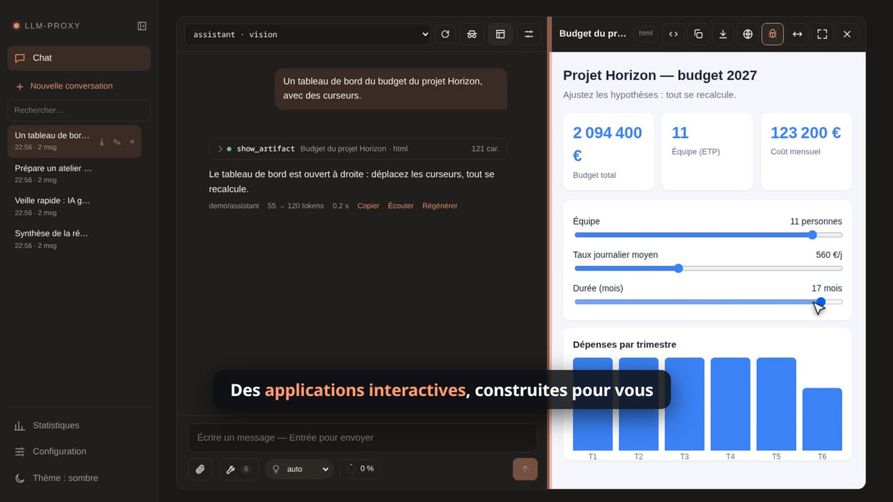
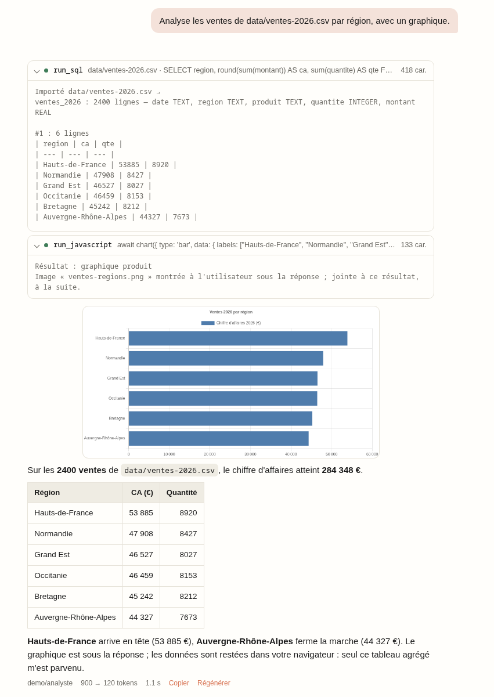

# llm-proxy

`llm-proxy` agrège plusieurs backends compatibles OpenAI derrière une URL. Il
accepte les serveurs locaux (llama.cpp, gufo, vLLM), les API hébergées et les
backends à quotas. Le préfixe du nom de modèle sélectionne le backend, par
exemple `bigchuck/qwen3.8-flash-next` ou
`silentchuck/qwen3-tts-12hz-1.7b-base`.

API exposées aux clients ; le backend reçoit des requêtes
`/v1/chat/completions` :

- **OpenAI Chat Completions** (`/v1/chat/completions`) : relayée sans
  traduction.
- **Anthropic Messages** (`/v1/messages`) : traduite en Chat Completions.
- **OpenAI Responses** (`/v1/responses`) : traduite en Chat Completions.

Fonctions disponibles autour du relais :

- un catalogue `/v1/models` unifié ;
- des **outils hébergés** que le proxy exécute pour le modèle : recherche
  et lecture web (SearXNG), OCR, transcription, génération d'images,
  mémoire persistante, exécution de code dans un bac à sable
  ([Exécution de code](docs/execution-de-code.md)), lecture de dépôts
  ([Dépôts](docs/depots.md)), envoi vers un webhook, serveurs MCP ;
- des **webhooks** par compte : un message reçu au format Slack, auquel un
  modèle répond, et des envois vers Slack, Mattermost, Discord, Teams,
  e-mail… par Apprise
  ([Webhooks](docs/webhooks.md)) ;
- des **comptes OIDC** et des clés par compte, chacune limitable à
  certains outils ; un partage équitable des tokens entre comptes ;
- un limiteur de quotas pour les backends qui en ont, des statistiques
  persistantes à la forme de l'Usage API d'OpenAI ;
- un tableau de bord : statistiques, chat, configuration (clés, comptes,
  webhooks, dépôts, bacs de l'exécuteur et caches) ;
- un conteneur durci (lecture seule, sans capacités Linux).

Le tableau de bord `/ui` inclut un chat connecté aux backends du proxy
([Chat](docs/chat.md)). Ses fonctions comprennent :

- **Conversations** persistées par compte : recherche, export Markdown,
  mode incognito, file d'attente des messages, jauge de contexte et sa
  répartition, `/compact` et résumé automatique.
- **Images** : génération avec le contexte des demandes précédentes, retouche
  d'images jointes, génération répétée et panneau en planche ou en grille.
- **Voix et transcription** : lecture par le navigateur ou par Qwen3-TTS,
  voix prédéfinies ou clonées ; studio de clonage depuis le micro, un fichier
  ou une description ; voix normalisées, persistées par compte, exportables
  et importables. Les modèles de voix et de transcription acceptent aussi
  les fichiers audio joints ou enregistrés dans le fil
  ([Voix](docs/voix.md)).
- **Outils du proxy** : recherche et lecture web avec sources, exécution de
  code, images, mémoire, dépôts, webhooks et serveurs MCP.
- **Outils de la page** : questions à choix (`ask_user`), artifacts HTML,
  Markdown, SVG ou Mermaid versionnés, modifiés par passages et débogués par
  le modèle dans un cadre isolé ; dossier local dont chaque écriture exige
  l'acceptation d'un diff.
- **Outils du navigateur** : accès à la position, au presse-papiers, à la
  caméra, aux captures d'écran, à l'agenda et aux QR codes après accord de
  l'utilisateur ; lecture à voix haute.
- **Runtimes dans l'onglet** : JavaScript, TypeScript (exécution et
  vérification de types), PHP 8.3, SQLite et PostgreSQL (PGlite). Ils
  travaillent sans réseau sur les fichiers du dossier ouvert, qui restent
  sur l'appareil. La VM Linux (v86, Alpine : bash, python3, git, sqlite) est
  partagée avec un terminal ; le proxy peut lui ouvrir l'accès réseau par un
  relais Wisp ([VM Linux](docs/linux.md)). Seuls les résultats sont transmis
  au modèle.
- **Programmes d'outils** : un programme JavaScript du bac enchaîne les outils
  hébergés sélectionnés (recherche, lecture, filtrage) dans un seul appel
  ([Programmes d'outils](docs/navigateur.md#programmes-doutils--run_tools_program)).
- **Gemini Nano** dans Chrome : modèle local exécuté sur l'appareil.

Vidéo de démonstration (1 min 20, sans son) : synthèse, recherche web,
questions, modification d'un artifact, graphique, requête SQL sur un dossier,
agenda et `/compact`. Le modèle utilisé suit un scénario préparé. L'interface,
les outils et les calculs présentés sont ceux du projet.

Captures détaillées des [outils du navigateur](docs/navigateur.md).

## Démarrage rapide

    cp .env.example .env        # les secrets : SEARXNG_SECRET, clés des backends…
    docker compose up -d --build
    curl -s http://localhost:8000/v1/models | jq '.data[].id'

La configuration est centralisée dans `data/config.toml`. Sans ce fichier,
`http://localhost:8000/ui` affiche la page d'installation. Elle génère le
`.env`, `data/config.toml` et `docker-compose.override.yml` à partir des
fournisseurs sélectionnés (NVIDIA, AMD, Groq, Mistral, OpenRouter, OpenCode
Go, Anthropic, Albert) et des options choisies. Placez les fichiers générés
dans la racine du déploiement, puis relancez Compose. En mode installation,
l'API répond 503. Chaque réglage est décrit dans `data/config.example.toml` ;
les variables d'environnement servent uniquement à fournir des secrets via
`${VAR}`.

L'image est publiée à chaque version sur `ghcr.io/c4software/llm-proxy`.
Pour l'utiliser, configurez `image:` dans l'override, puis exécutez
`docker compose pull && docker compose up -d` sans construire l'image
([Déploiement](docs/deploiement.md#limage-publiée)).

Le guide [Monter son propre proxy](https://cours.brosseau.ovh/tp/agentic/proxy.html)
décrit le déploiement avec NVIDIA, AMD et d'autres fournisseurs, puis la
configuration d'OpenCode comme client.

## Documentation

| Sujet | Fichier |
|---|---|
| Ce que fait le proxy, fonction par fonction | [Fonctionnalités](docs/fonctionnalites.md) |
| Le dépôt, ses dossiers et ses fichiers | [Architecture](docs/architecture.md) |
| Docker Compose, Coolify, sauvegarde | [Déploiement](docs/deploiement.md) |
| `data/config.toml`, table par table | [Configuration](docs/configuration.md) |
| Clés, comptes OIDC, ce qui se sert sans clé, conteneur durci | [Sécurité](docs/securite.md) |
| `/ui` : statistiques, partage équitable, comptes et clés (droits d'outils), webhooks, dépôts, bacs et caches | [Tableau de bord](docs/tableau-de-bord.md) |
| Le chat de la page : conversations, modèles d'images, de voix et de transcription, contexte, outils (questions, dossier, artifacts) | [Le chat](docs/chat.md) |
| Position, caméra, presse-papiers… et JavaScript, TypeScript, PHP, SQLite, PostgreSQL dans le navigateur | [Les outils du navigateur](docs/navigateur.md) |
| Une VM Linux dans l'onglet (bash, python3), partagée avec un terminal : réseau par relais Wisp, construction et limites | [La VM Linux du navigateur](docs/linux.md) |
| L'Usage API d'OpenAI servie par le proxy | [Statistiques](docs/statistiques.md) |
| `/v1/messages` : traduction, `model_map`, `[anthropic]` | [API Anthropic Messages](docs/api-anthropic.md) |
| `/v1/responses` : traduction, outils, `[responses]` | [API OpenAI Responses](docs/api-responses.md) |
| Recherche web, OCR, transcription, images, mémoire et MCP | [Outils hébergés](docs/outils-heberges.md) |
| Synthèse vocale, création et clonage de voix (Qwen3-TTS) | [Voix](docs/voix.md) |
| Bac à sable de `code_execution` et lecture des dépôts | [Exécution de code](docs/execution-de-code.md) |
| Webhooks entrants et sortants par compte | [Webhooks](docs/webhooks.md) |
| Sources GitLab, GitHub, Gitea ou Git et outils de lecture | [Dépôts](docs/depots.md) |
| Contrat pour écrire un outil hébergé | [Outils hébergés : le contrat](docs/outils.md) |
| Extensions Python du proxy et JavaScript du navigateur | [Extensions](docs/extensions.md) |
| Vérifier un déploiement | [Vérification](docs/verification.md) |
| Limites connues | [Limites connues](docs/limites.md) |
| Bancs de validation avec clients réels | [bench/README.md](bench/README.md) |
| Consignes de contribution : code, documentation, tests | [AGENTS.md](AGENTS.md) |
