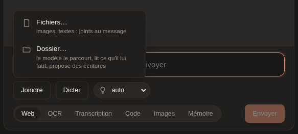
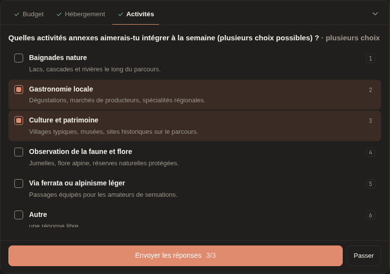
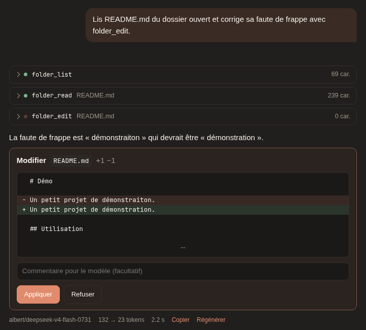
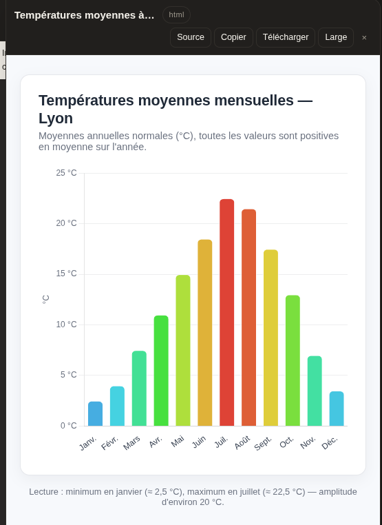

# Le chat

Le chat est une interface de conversation sur les backends du proxy,
dans la page `/ui` (<kbd>#chat</kbd>). Il est **fermé par défaut** :
`[ui] chat = true` dans `config.toml` l'ouvre. Fermé, l'onglet le dit et
`POST /ui/chat/completions` répond `404`. Ses requêtes sont comptées à la
clé connectée, comme toute requête de l'API.

## Conversations

Les conversations sont gardées par le proxy (`data/conversations.db`)
et liées au **compte** : on les retrouve sur tout navigateur et tout
appareil. Chacune garde son modèle, son prompt système, sa température,
ses outils, ses artifacts et ses fichiers produits.

- Dans le menu latéral : renommer, supprimer, **rechercher** (chaque
  mot, sans casse ni accents, dans le titre ou les messages ; le proxy
  cherche aussi dans celles que le menu n'a pas encore lues).
- **Chargement à la demande** : le menu ne lit que des résumés (titre,
  date, nombre de messages), 40 à la fois, la suite en arrivant au bout
  de la liste ; une conversation n'arrive entière qu'ouverte. L'adresse
  nomme la conversation affichée (`/ui#chat/<id>`) : un rechargement la
  rouvre, lue en même temps que la première page du menu.
- Dans le fil : modifier une question (la suite repart d'elle),
  régénérer la dernière réponse, arrêter un flux.
- **Export** Markdown (⤓ dans le menu, ou *Réglages*) : titre, date,
  modèle, prompt système, messages, fichiers texte joints, sources, et
  images en data URL. Le raisonnement n'y est pas.
- **Images** (jointes, générées, retouchées) : gardées à part sous
  `/ui/assets/<id>` (PNG, JPEG, GIF, WebP, reconnus à leurs octets). Une
  image que plus rien ne cite est effacée après dix minutes.
- **Bornes** (`[ui]`) : `conversation_max_bytes`, `asset_max_bytes`,
  `history_max_bytes`.
- **File d'attente** : pendant une réponse, Entrée met le message en
  file. Il part à la fin d'une réponse réussie, dans l'ordre. Une réponse
  arrêtée ou en erreur met la file en pause (*Envoyer la suite* la
  relance). Un message en file se modifie ou se retire.
- **Notifications** (*Réglages*) : une réponse finie ou une question qui
  attend, onglet en arrière-plan, marque le titre (« ● ») et envoie une
  notification si elle est permise.

### Incognito

Le bouton de l'en-tête ouvre une conversation **jamais envoyée** à
l'historique. Elle disparaît dès qu'on la quitte ou qu'on recharge. Sur
une conversation vide, le bouton la bascule ; sur une conversation
commencée, il en ouvre une neuve.

Ses requêtes portent `X-Incognito: 1` (jamais relayé au backend). Le
proxy n'en garde **rien** au-delà de la réponse :

- ni [mémoire des résultats](outils-heberges.md#mémoire-des-résultats),
  ni cache web (recherches, pages, OCR, transcriptions) ;
- l'outil `memory` est retiré, même déclaré ;
- un fichier rendu par un outil n'est gardé que le temps de s'afficher :
  `[files].incognito_ttl`, 900 s par défaut (au plus `[files].ttl`).

Restent les statistiques (des comptes, sans contenu) et le bac
d'exécution de code du tour, qui expire normalement.

## Modèles

La liste est groupée par backend, avec le nom court du modèle
(l'identifiant complet au survol). Le catalogue est gardé dans le
navigateur et relu en arrière-plan ; ↻ le relit à la demande. Côté
proxy, chaque catalogue est gardé `[proxy].catalog_ttl`.

**Niveau de réflexion**, par conversation, dans la zone de saisie :

| Choix | Envoyé au backend |
|---|---|
| *auto* | rien (comportement du modèle) |
| *non* | `chat_template_kwargs: {"enable_thinking": false}` (coupe un modèle hybride comme Qwen3 ; gpt-oss réfléchit toujours un peu) |
| *faible* / *moyenne* / *élevée* | `reasoning_effort` low / medium / high |

Sur llama.cpp, `reasoning_effort` active la réflexion d'un Qwen3. Sur
vLLM (Albert), il règle celle de gpt-oss.

**Gemini Nano** (Chrome, API Prompt) apparaît sous *Dans le navigateur*
quand Chrome le propose. Il répond **sur l'appareil**, sans le proxy.

- Le premier usage télécharge le modèle (plusieurs Go). La première
  réponse prend ensuite une vingtaine de secondes.
- Il sait répondre à `ask_user`, mais n'a ni outils, ni niveau de
  réflexion, ni dossier : ces contrôles sont masqués.

**Modèles d'images** (*Images · backend* dans le sélecteur) :

- Le modèle reçoit le dernier message **avec son contexte** : les
  demandes précédentes de la même suite d'images. « plus sombre » suit
  « un phare au coucher du soleil ». Le prompt envoyé se relit sous
  l'image.
- Une image jointe, ou reprise par *Retoucher*, est retouchée
  (`/ui/images/edits`) : seule la consigne part. Le backend doit servir
  `/v1/images/edits`.
- 1 à 4 images par demande, une requête chacune. Tailles :
  `[tools.image_generation].sizes`, `size` par défaut.
- *Générer encore* (sous la réponse, avec un nombre de 1 à 4) : d'autres
  images avec le **même prompt**, tel qu'envoyé — rien du fil depuis —,
  jointes à la même réponse (et la même image retouchée, si c'en était une).
- Un clic agrandit l'image (Échap ferme ; ← → passent aux autres images
  de la conversation), pour la télécharger ou la retoucher. Elle est
  gardée avec la conversation.

**Panneau Images** (bouton *Images (n)* de l'en-tête, dès qu'il y en a
une) : toutes les images générées de la conversation — modèle d'images,
outil *Images*, graphiques d'un script, captures —, pas celles jointes
aux questions. Une en grand, *Précédent* / *Suivant* (ou ← →), la
planche des vignettes ; chacune se télécharge, se retouche ou se
retrouve dans le fil.
- Les fichiers texte et une seconde image ne sont pas envoyés ; la page
  le dit.

Pour qu'un modèle de conversation génère une image au fil d'une réponse,
cochez l'outil *Images* ([génération d'images](outils-heberges.md#génération-dimages)).

## Saisie et affichage

**Pièces jointes** (bouton *Joindre → Fichiers…*, glisser-déposer ou
coller) :

- images en `image_url`, 8 Mo au plus. La page prévient si le catalogue
  ne dit pas le modèle capable de les lire ;
- fichiers texte, 256 Ko au plus, joints entre balises `<file name="…">` ;
- le reste est refusé.

*Joindre → Dossier…* ouvre un [dossier](#dossier-ouvert).

**Le clavier** :

- **Le focus** revient au champ de saisie quand l'onglet du navigateur le
  reprend, ou quand on revient sur la vue Chat. Il n'est jamais volé à un
  autre champ, un menu, la feuille de questions, un artifact ou une
  sélection de texte, et jamais sur un écran étroit, où il ouvrirait le
  clavier.
- **Échap arrête la génération en cours.** La touche garde d'abord ses
  autres rôles : fermer l'image agrandie, annuler la modification d'un
  message, replier la feuille de questions.

**Modifier un message** : la flèche du haut, dans un champ vide, remet le
dernier message dans la zone de saisie ; *Modifier*, sous un message, fait
de même pour n'importe lequel. Un bandeau le signale, et rien n'est retiré
de la conversation tant qu'on n'a pas envoyé. L'envoi reprend la
conversation de ce message : ce qui le suivait disparaît. **Échap**, ou
vider le champ, annule la modification.

**Rendu Markdown** : titres, listes, tableaux, citations, code avec
*Copier*, liens et images. Tout le texte est échappé : aucun HTML du
modèle ne passe. Seuls `http(s)`, `mailto` et les chemins du proxy
(`/v1/files/…`) font un lien.

**Raisonnement** : plié par défaut au-dessus de la réponse. Plié, il
montre une seule phrase complète, renouvelée au plus toutes les 1,8 s
pendant le flux. Tokens et durée s'affichent sous la réponse.

**Voix** : *Écouter*, sous une réponse, la lit avec la **synthèse
vocale du navigateur** : tout de suite, sans passer par un modèle (sans
code ni Markdown, 20 000 caractères au plus). Le texte est lu phrase par
phrase, ce qui évite les coupures de certaines voix en ligne ; *Arrêter
la lecture* l'interrompt. La voix (celles du navigateur, la langue de la
page d'abord) et le débit se choisissent dans *Réglages* ; l'outil
`speak` les reprend.

**Mémoire** (si `[tools.memory]` est actif) : le bouton *Mémoire* de
l'en-tête ouvre le panneau des fichiers mémoire de la clé, à lire,
corriger ou effacer. Il se relit après chaque appel à l'outil `memory`,
affiché lisiblement (« `create /memories/…` »).

## Contexte et résumé

La barre de saisie montre une **jauge** du contexte. Elle compare ce que
la conversation occupe chez le modèle à la fenêtre de contexte annoncée
par le catalogue.

- Elle part de la dernière mesure du modèle : `prompt_tokens` et
  `completion_tokens` de son dernier tour.
- Ce qui a suivi cette mesure est estimé (préfixe « ≈ »).
- Elle vire à l'orange à 60 %, puis à la couleur d'accent au seuil du
  résumé automatique.
- Son menu montre la **répartition** du contexte, en barre et en légende :
  prompt système, résumé, consignes et définitions des outils, messages,
  appels d'outils et leurs résultats, outils hébergés, images, et ce qui
  reste libre. Les parts sont estimées (≈ 3,5 caractères par token) ;
  l'écart avec la mesure du modèle est « non attribué » (son gabarit,
  l'erreur de l'estimation).
- Les **outils hébergés** (recherche web, lecture de pages, MCP…)
  tournent dans le proxy : leurs résultats n'arrivent jamais dans la
  page, et le proxy les réinsère lui-même à la requête suivante
  ([chat].memory). Il en donne la taille à la page à la fin de chaque
  réponse (`x_hidden`, en caractères), qui en fait une part à elle.

**`/compact [consigne]`** résume la conversation. On peut aussi passer par
*Résumer maintenant* dans le menu de la jauge. Taper `/` propose la
commande, et Tab la complète.

- Le modèle de la conversation écrit le résumé, sans outils ni réflexion.
- Le résumé devient un message du fil, plié.
- Les messages qui le précèdent restent affichés, mais estompés : ils ne
  partent plus au modèle. Le résumé part à leur place, à la suite du
  prompt système.
- *Annuler le résumé* rend tout l'historique au modèle.
- Le résumé est gardé avec la conversation.

Les **outils cochés coûtent aussi du contexte**, à chaque requête : leurs
fonctions (nom, description, paramètres) et la consigne de leur famille
au prompt système.

- Le menu Outils donne, sous chaque choix, son coût estimé (≈ tokens), et
  en bas le total des outils cochés.
- *Voir le prompt invisible* (en bas du menu, ou dans Réglages) montre ce
  que le prochain message enverra en plus du fil : le prompt système
  composé (le sien, un résumé, les consignes des outils) et chaque
  fonction déclarée, celles de la page comme celles que le proxy ajoute
  pour les outils hébergés (`/ui/session` les décrit).

Le **résumé automatique** est actif par défaut, et le menu de la jauge le
coupe ; ce choix est gardé par navigateur.

- Il se déclenche avant l'envoi d'un message, quand le contexte dépasse
  80 % de la fenêtre.
- Il résume ce qui précède ce message, puis envoie le message.
- Il ne se déclenche jamais pour un modèle dont la fenêtre est inconnue.

Une réponse refusée par le backend pour un contexte trop long propose
*Résumer la conversation et réessayer*. Si même la demande de résumé
déborde, elle est refaite sur un historique **allégé** : chaque message
est coupé en son milieu et les images sont retirées. Le résumé l'indique.

## Outils

Le menu **Outils** de la zone de saisie a une case par outil, cochée par
conversation : ceux **du proxy**, puis ceux **du navigateur**. Le bouton
dit combien sont actifs. Un modèle qui ne sait pas appeler d'outils
(Gemini Nano, un modèle d'images) n'a pas ces cases.

### Outils du proxy

Avec `[chat] hosted_tools = true`, la section *Proxy* propose les
[outils hébergés](outils-heberges.md) :

- *Web* : `{"type": "web_search"}`, soit `web_search`, `web_fetch`,
  `web_grep` ;
- *Code*, *Images*, *Mémoire* (l'outil `memory`) ;
- un par serveur MCP configuré : `{"type": "mcp:<serveur>"}`.

Les cases **font foi** : `[chat].always` ne s'ajoute pas aux requêtes du
chat.

Chaque appel s'affiche pendant qu'il tourne, puis replié avec le début
de son résultat. Un refus par limite d'appels s'affiche comme tel
(`status: "limit"`). Les sources citées s'affichent en pastilles sous la
réponse. Le proxy annonce ces appels par un champ hors schéma,
`delta.x_hosted_tool`, envoyé au seul chat de la page.
L'échange caché (appels et résultats) n'est pas dans l'historique de la
page : la [mémoire des résultats](outils-heberges.md#mémoire-des-résultats)
du proxy le réinsère au tour suivant.

### Outils de la page

La page déclare aussi des outils qu'**elle exécute elle-même**. Le
proxy les lui rend en `tool_calls` ; la page les exécute et relance le
modèle, 25 tours au plus par réponse. Les appels restent dans
l'historique : au message suivant, le modèle retrouve ce qu'il a lu ou
produit. Il faut un modèle qui sait appeler des outils.

Certains **attendent l'utilisateur** : une feuille en bas du chat pour
une question, une carte dans le fil pour une écriture. L'attente survit
à un rechargement. Écrire un nouveau message à la place la clôt sans
réponse.

| Outil | Ce qu'il fait | Attend l'utilisateur |
|---|---|---|
| `ask_user` | 1 à 4 questions à choix (unique ou multiple), avec « Autre » libre | oui |
| `show_artifact` | page HTML, Markdown, SVG, Mermaid ou code dans le panneau latéral ; même `id` = nouvelle version | non |
| `edit_artifact` | remplace des passages exacts (uniques, ou `replace_all`) de la dernière version — ou, avec `regex`, une expression régulière (groupes `$1` dans le remplacement) ; tous ou aucun → nouvelle version | non |
| `read_artifact` | relit la dernière version d'un artifact, entière ou par tranche de lignes numérotées (`start_line`, `end_line`) | non |
| `grep_artifact` | cherche un texte (ou une expression régulière) dans la dernière version : les lignes trouvées, numérotées, avec leur contexte | non |
| `inspect_artifact`, `run_in_artifact` | console, erreurs, page, capture ; un script dans la page affichée (débogage actif par défaut) | non |
| `request_artifact_debug` | propose de rétablir le débogage d'un artifact coupé par l'utilisateur | oui : *Activer le débogage* ou *Non merci* |
| `save_file` | un fichier texte (CSV, script…) sous la réponse : un clic l'ouvre en aperçu (Markdown rendu), d'où il se copie ou se télécharge | non |
| [*outils du navigateur*](navigateur.md) | position, notifications, caméra… par famille | selon l'outil |
| `folder_list`, `folder_read`, `folder_search` | parcourir, lire (tranches numérotées), chercher dans le dossier ouvert | non |
| `folder_write`, `folder_edit` | créer ou remplacer un fichier, remplacer un passage exact | oui : diff, *Appliquer* ou *Refuser* |

Tous ces outils suivent la même interface de code (`chat/tools/`) : voir
[Écrire un outil de la page](navigateur.md#écrire-un-outil-de-la-page).

#### Questions

`ask_user` sert quand une décision revient à l'utilisateur. La feuille
couvre la zone de saisie : un onglet par question, les options avec leur
description, *Autre* en dernier.

- Plusieurs questions : le bouton principal fait **Suivant** dès que la
  question a sa réponse (un choix unique passe tout seul à la suivante).
  Un dernier onglet, **Récapitulatif**, montre chaque question et sa
  réponse sur une ligne ; un clic sur une ligne y revient pour la changer,
  une question sans réponse y est signalée. On envoie de là (*Envoyer les
  réponses*).
- Une question seule : *Envoyer la réponse*, sans récapitulatif.
- *Passer* répond sans rien choisir.

| Touche | Action |
|---|---|
| `1`…`9` | choisir (un choix unique passe à la question suivante) |
| `←` / `→` | changer d'onglet |
| Entrée | le bouton principal : *Suivant*, ou envoyer depuis le récapitulatif |
| Échap | replier la feuille, pour relire le fil ou écrire autre chose |

#### Dossier ouvert

*Joindre → Dossier…* donne au modèle un dossier local. Le dossier reste
**dans le navigateur** : le modèle ne lit que ce qu'il ouvre.

- Ignorés : `.git`, `node_modules`, environnements Python, caches. Un
  fichier binaire est refusé.
- Après un rechargement, il faut **rouvrir** le dossier : le navigateur
  ne rend pas l'accès tout seul.
- Chaque écriture proposée s'affiche en **diff** (3 lignes de contexte),
  avec un commentaire facultatif. **Rien n'est écrit sans *Appliquer*.**
- Sous Chrome et Edge, le fichier est écrit sur le disque (accès demandé
  à la première écriture). Ailleurs, il est téléchargé. Le modèle relit
  ensuite la nouvelle version.

#### Artifacts

Le bouton *Artifacts* de l'en-tête ouvre le panneau, à droite du fil :
un artifact à la fois, ses versions, *Source*, *Copier*, *Télécharger*,
*Réseau*, *Débogage*, *Large*, *Plein écran* (Échap pour en sortir). La
poignée du bord gauche redimensionne le panneau (double-clic : largeur
par défaut ; aussi au clavier, flèches) ; la largeur reste dans ce
navigateur. Les artifacts sont gardés avec la conversation.

**Déboguer un artifact.** Quand un artifact ne marche pas, le modèle peut
le tester tel qu'il tourne dans le panneau, sous vos yeux : lire sa
console et ses erreurs, exécuter du code dans la page (cliquer, saisir,
lire un état), la capturer en image. C'est **actif par défaut** :

- le bouton *Débogage* du panneau le coupe, ou le rétablit, pour cet
  artifact ; basculer recharge l'artifact (le script de débogage s'y
  ajoute ou s'en retire) ;
- coupé, quand vous signalez un problème, le modèle propose de le
  rétablir sur une carte (*Activer le débogage*, *Non merci*) ;
- un bandeau signale quand le modèle est en train de tester ;
- l'artifact reste isolé : le modèle n'atteint que sa page, ni la vôtre,
  ni votre session.

**L'historique ne rejoue pas les anciens contenus.** Au message suivant,
le modèle ne reçoit plus le texte complet d'un `show_artifact` ou d'un
`read_artifact` passé, mais une mention (« N caractères, non rejoué ») :
il travaille sur la version actuelle : il y retrouve le passage avec
`grep_artifact`, en lit les lignes avec `read_artifact` (`start_line`,
`end_line`), puis le retouche avec `edit_artifact` — sans relire tout
l'artifact. Une consigne lui donne les
artifacts de la conversation, leur version et leur taille. L'historique
d'une conversation à gros artifacts s'en trouve divisé par deux, et le
modèle ne réécrit plus tout faute de savoir quelle version est la bonne.

Le modèle inspecte (`inspect_artifact` : console depuis le chargement,
erreurs, page en texte, capture à la demande), reproduit
(`run_in_artifact`, avec `click`, `type`, `key`, `wait`, `text`, `all`),
corrige (`edit_artifact`) puis revérifie. La capture passe par
html-to-image, servi par le proxy : rien n'est chargé d'ailleurs.

Un artifact est **isolé** : cadre `sandbox` sans `allow-same-origin`,
sans accès à la page, à sa session ni à ses clés. Sa politique de
contenu autorise les scripts et styles en ligne et les bibliothèques de
cdnjs, jsdelivr ou unpkg. **Aucune autre requête réseau** : ni `fetch`,
ni image distante, ni formulaire.

Le bouton **Réseau** (le globe) ouvre internet à cet artifact seulement
(cartes, tuiles, API publiques).

> **Attention** : écrit par le modèle, l'artifact peut alors envoyer son
> contenu à n'importe quel site. Il reste isolé de la page et les
> formulaires restent bloqués.

Le choix est gardé avec l'artifact (globe en couleur) et se coupe d'un
clic.

### Outils du navigateur

Le modèle peut aussi solliciter l'**appareil** : heure et état de
l'appareil, position, notifications, presse-papiers, agenda, liens,
partage, capture d'écran, caméra, codes, pipette, écran allumé, lecture
à voix haute. Il peut aussi faire tourner du **JavaScript**, du
**TypeScript**, du **PHP** ou du **SQL** dans un bac isolé, sur les
fichiers du dossier ouvert. Ces outils se cochent par famille, dans la
section *Navigateur* du menu **Outils**.

Ce qui touche à l'appareil passe toujours par une carte que
l'utilisateur accepte ou refuse. Ce qui reste utile après la réponse
(un lien, un texte à partager ou à recopier, un rappel) laisse une
**carte durable** sous la réponse, rejouable à volonté.

Chaque outil, avec un exemple et sa capture :
[Les outils du navigateur](navigateur.md).

## Routes

Toutes valent pour le compte connecté, sous le cookie de la page. Les
corps JSON sont exigés (`415` sinon) : une page tierce ne peut pas en
envoyer sans requête CORS préliminaire, que le proxy ne sert pas.

| Route | Rôle |
|---|---|
| `GET /ui/models` | modèles de conversation (ni image, ni voix, ni embeddings), `vision` si le catalogue le dit ; `?images=1` ajoute les modèles d'images (`image`) |
| `POST /ui/chat/completions` | `/v1/chat/completions` |
| `POST /ui/images/generations` | `/v1/images/generations` |
| `POST /ui/images/edits` | corps JSON (`model`, `prompt`, `image` en data URL, `size`) converti en formulaire pour `/v1/images/edits` |
| `POST /ui/audio/speech`, `GET /ui/audio/voices` | `/v1/audio/*` |
| `GET /ui/conversations` | conversations ; `?summary=1&limit=&offset=` : leurs résumés par pages (`next` : la page suivante) ; `?q=` : les résumés de celles qui contiennent chaque mot |
| `GET` / `PUT` / `DELETE /ui/conversations/{id}` | une conversation |
| `POST /ui/assets`, `GET /ui/assets/{id}` | images des conversations |
