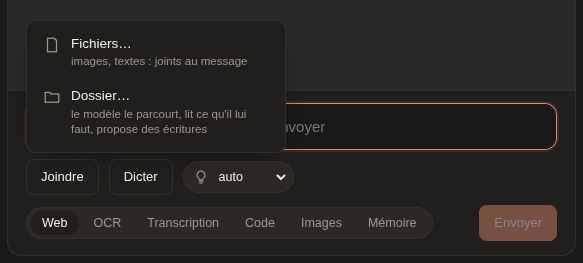
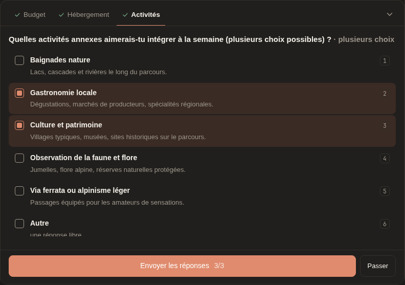
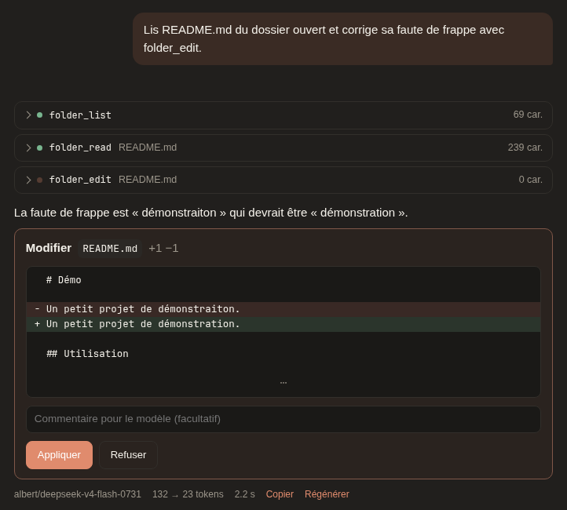
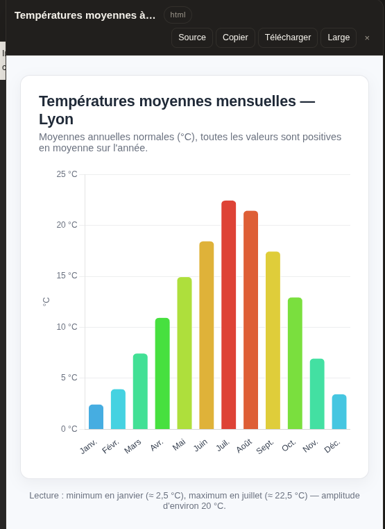

# Le chat

La page `/ui` (onglet `#chat`) fournit une interface de conversation avec les
backends du proxy. Le chat est désactivé par défaut : `[ui] chat = true` dans
`config.toml` l'active. Lorsqu'il est désactivé, l'onglet l'indique et
`POST /ui/chat/completions` répond `404`. Les requêtes sont imputées à la clé
connectée, comme les autres requêtes de l'API.

## Conversations

Le proxy stocke les conversations dans `data/conversations.db` et les associe au **compte** : elles sont accessibles depuis tout navigateur et appareil. Chaque conversation conserve son modèle, son prompt système, sa température, ses outils, ses artifacts et les fichiers produits.

Un [webhook entrant](webhooks.md) ajoute également des messages à l'historique,
marqués « reçu par le webhook … ». La page les affiche sans rechargement.
Pendant la réponse déclenchée par le webhook, la conversation affiche une
réponse en cours, pilotée par le proxy ; la page n'écrit pas dans la
conversation avant la fin de cette réponse. Une nouvelle conversation reprend
les réglages de la conversation affichée (modèle, prompt système, outils…),
sauf si celle-ci a été créée par un webhook ; dans ce cas, elle utilise les
réglages par défaut.

- Le menu latéral permet de renommer, supprimer et **rechercher** des conversations. La recherche porte sur chaque mot, sans distinction de casse ni d'accents, dans le titre et les messages ; elle inclut les conversations que le menu n'a pas encore chargées.
- **Chargement à la demande** : le menu charge uniquement des résumés (titre, date, nombre de messages), par lots de 40. Il charge le lot suivant à l'arrivée en bas de la liste. Une conversation complète est chargée à son ouverture. L'adresse indique la conversation affichée (`/ui#chat/<id>`) ; un rechargement la rouvre et charge en parallèle la première page du menu.
- Dans le fil, il est possible de modifier une question (la génération reprend à partir de celle-ci), de régénérer la dernière réponse ou d'arrêter un flux. *Arrêter* interrompt également l'outil de la page en cours (un bac JavaScript, PHP ou SQL est supprimé immédiatement) ; les appels restants reçoivent un résultat d'erreur.
- **Réponse coupée** : si la limite de tokens du modèle interrompt une réponse (`finish_reason: length`) ou si le flux se ferme sans `[DONE]`, un message l'indique sous la réponse et propose *Continuer* (un message demandant la suite). Si la page est rechargée pendant une réponse, celle-ci est marquée « interrompue » et ses outils en cours sont mis en erreur ; *Reprendre* relance le modèle sur le même message.
- **Enregistrement** : au plus une fois par seconde, puis toutes les 5 s
  pendant un flux, et immédiatement lorsque l'onglet est masqué (requête
  `keepalive`, qui se poursuit même après sa fermeture). Le proxy associe une
  **révision** à chaque conversation. Si un onglet enregistre une version
  antérieure à celle déjà présente (modifiée dans un autre onglet ou appareil),
  le proxy répond `409` au lieu de l'écraser. Un bandeau propose alors
  *Reprendre l'autre version* ou *Garder celle-ci* ; aucun enregistrement
  n'a lieu avant ce choix.
- **Export Markdown** (⤓ dans le menu ou *Réglages*) : titre, date,
  modèle, prompt système, messages, fichiers texte joints, sources et
  images en data URL. Le raisonnement n'est pas inclus.
- **Images** (jointes, générées, retouchées) : stockées séparément dans
  `/ui/assets/<id>` (PNG, JPEG, GIF, WebP, reconnus à leurs octets). Une
  image qui n'est plus référencée est supprimée après dix minutes.
- **Bornes** (`[ui]`) : `conversation_max_bytes`, `asset_max_bytes`,
  `history_max_bytes`.
- **File d'attente** : pendant une réponse, Entrée ajoute le message à
  la file. Les messages sont envoyés dans l'ordre à la fin d'une réponse
  réussie. Une réponse arrêtée ou en erreur met la file en pause ;
  *Envoyer la suite* la relance. Un message en file peut être modifié ou
  supprimé.
- **Notifications** (*Réglages*) : lorsqu'une réponse se termine ou
  qu'une question attend une réponse alors que l'onglet est en arrière-plan,
  le titre est marqué (« ● ») et une notification est envoyée si elle est permise.

### Incognito

Le bouton de l'en-tête ouvre une conversation **qui n'est pas enregistrée**
dans l'historique. Elle disparaît dès qu'on la quitte ou recharge la page.
Sur une conversation vide, le bouton active ou désactive ce mode ; sur
une conversation commencée, il ouvre une nouvelle conversation.

Les requêtes de cette conversation portent `X-Incognito: 1` (jamais relayé
au backend). En mode incognito, le proxy applique les règles suivantes :

- La [mémoire des résultats](outils-heberges.md#mémoire-des-résultats) et le
  cache web (recherches, pages, OCR, transcriptions) sont désactivés ;
- l'outil `memory` est retiré, même s'il est déclaré ;
- un fichier produit par un outil est conservé uniquement le temps de son
  affichage : `[files].incognito_ttl`, 900 s par défaut (au plus `[files].ttl`) ;
- les journaux d'un appel d'outil hébergé ne contiennent ni ses arguments
  (recherche, URL, code) ni son texte, mais son nom, sa taille, sa durée
  et son code d'erreur.

Les statistiques (sans contenu) et le bac d'exécution de code du tour
restent disponibles ; ce dernier expire normalement.

## Modèles

La liste est groupée par backend et affiche le nom court du modèle
(l'identifiant complet apparaît au survol). Le navigateur conserve le
catalogue et le relit en arrière-plan ; ↻ déclenche sa relecture. Le proxy
conserve chaque catalogue pendant `[proxy].catalog_ttl`.

**Niveau de réflexion**, par conversation, dans la zone de saisie :

| Choix | Envoyé au backend |
|---|---|
| *auto* | rien (comportement du modèle) |
| *non* | `chat_template_kwargs: {"enable_thinking": false}` (coupe un modèle hybride comme Qwen3 ; gpt-oss réfléchit toujours un peu). Seulement vers un backend [`chat_template`](configuration.md#backendsnom) ; ailleurs, comportement du modèle |
| *faible* / *moyenne* / *élevée* | `reasoning_effort` low / medium / high |

Sur llama.cpp, `reasoning_effort` active la réflexion d'un Qwen3. Sur
vLLM (Albert), il règle celle de gpt-oss.

**Gemini Nano** (Chrome, API Prompt) apparaît sous *Dans le navigateur*
lorsque Chrome le propose. Il génère les réponses **sur l'appareil**, sans
passer par le proxy.

- À la première utilisation, le navigateur télécharge le modèle (plusieurs
  Go). La première réponse prend ensuite une vingtaine de secondes.
- Le modèle peut répondre à `ask_user`, mais ne prend en charge ni outils,
  ni niveau de réflexion, ni dossier ; ces contrôles sont masqués.

**Modèles d'images** (*Images · backend* dans le sélecteur) :

- Le modèle reçoit le dernier message **avec son contexte**, c'est-à-dire
  les demandes précédentes de la même suite d'images. « plus sombre » fait
  ainsi suite à « un phare au coucher du soleil ». Le prompt envoyé est
  affiché sous l'image. Le réglage *Contexte → message seul* (par
  conversation) limite l'envoi au dernier message.
- Une image jointe ou reprise avec *Retoucher* est traitée par
  `/ui/images/edits` ; seule la consigne est envoyée. Le backend doit
  servir `/v1/images/edits`.
- Chaque demande génère de 1 à 4 images, avec une requête par image. Les
  tailles sont définies par `[tools.image_generation].sizes` ; `size` est
  la taille par défaut.
- Les passes de débruitage (un nombre inférieur accélère le traitement
  mais réduit le niveau de détail) sont proposées uniquement pour les
  modèles déclarés dans `[tools.image_generation].steps`. La valeur par
  défaut est *auto* (valeur du modèle). Les modèles à passes fixes, comme
  Qwen-Image-2.1-Turbo, n'ont pas de sélecteur.
- Les LoRA (adaptateurs de style ou de contenu, force 1) sont proposés
  uniquement pour les modèles déclarés dans `[tools.image_generation].loras`.
  La valeur par défaut est *sans LoRA*. Ils s'appliquent aux générations
  et aux retouches, mais pas à *Agrandir*, qui utilise un autre modèle.
- *Agrandir* (×1,5, ×2…, sous une image ou dans l'image agrandie) est
  disponible si `[tools.image_generation].upscale_model` est défini. Ce
  modèle retouche l'image à une taille supérieure avec une consigne fixe.
  Il **redessine** l'image : la résolution augmente réellement, mais les
  détails peuvent changer. Le résultat apparaît dans une nouvelle
  réponse. Mesure du 08/11/2026 avec Qwen-Image-2.1-Turbo sur gufo :
  passage de 1024² à 2048² en 182 s, bascule du modèle de texte comprise ;
  le texte de l'image est resté intact et la composition a été conservée.
  À côté du facteur, la force est réglée par `upscale_strengths` (« Détaillé
  (1) » par défaut, « Équilibré (0,6) », « Fidèle (0,4) ») : une force
  plus faible préserve davantage l'image, mais ajoute moins de détails.
- *Générer encore* (sous la réponse, nombre de 1 à 4) génère d'autres
  images avec le **même prompt** que celui envoyé (sans le reste du fil).
  Elles sont jointes à la même réponse, avec la même image retouchée le
  cas échéant.
- Un clic ouvre l'image en grand (Échap la ferme ; ← → passent aux autres
  images de la conversation), pour la télécharger ou la retoucher. L'image
  est conservée avec la conversation.

**Modèles de voix** (*Voix · backend* dans le sélecteur, modèles
`text-to-speech` ; voir [Voix](voix.md)) : le texte du message est
synthétisé en audio. La réponse est lue dans un lecteur intégré au fil,
qui démarre automatiquement ; un seul audio est lu à la fois. *Télécharger*
enregistre l'audio en WAV. Il est conservé avec la conversation
(`/ui/assets`), comme une image. Le comportement dépend du modèle :

- *voix toutes faites* (`…-customvoice`) : la voix se choisit dans la
  barre de saisie ; le prompt système (*Réglages*) définit le ton.
- *voix clonée* (`…-base`) : la barre permet de choisir une voix clonée
  du compte. *＋ nouvelle voix…* ouvre le studio dans une fenêtre au-dessus
  de la conversation (voir *Voix clonées* plus bas) ; la voix conservée
  devient celle de la conversation.
- *voix décrite* (`…-voice-design`) : le prompt système **décrit** la
  voix (genre, âge, timbre, accent, style) ; une nouvelle voix est créée
  pour chaque message.

Un texte de 6 000 caractères au plus est découpé en passages, puis réuni
en un seul audio. La langue provient des réglages de la voix, ou, à défaut,
de ceux du navigateur. Les outils et pièces jointes ne sont pas pris en
charge.

**Modèles de transcription** (*Transcription · backend* dans le
sélecteur, modèles `automatic-speech-recognition` comme Qwen3-ASR ou
Whisper) : le modèle transcrit l'audio du message. La réponse textuelle
peut être copiée, écoutée ou reprise dans la même conversation en
sélectionnant un modèle de conversation.

- Joindre un audio avec *Joindre → Fichiers…*, glisser-déposer ou coller
  (WAV, MP3, M4A, Ogg, FLAC, WebM, 20 Mo au plus), ou l'enregistrer avec
  le bouton *Micro* de la barre (10 minutes au plus ; *Arrêter* le joint
  au message). Chaque audio est transcrit dans un paragraphe distinct.
- Le texte du message est facultatif et sert de guide au modèle (`prompt` :
  noms propres, vocabulaire).
- Le traitement s'effectue dans la page : l'audio est décodé, converti
  en WAV mono à 16 kHz (Qwen3-ASR ne lit que ce format). Un audio long est
  découpé en passages d'une minute au plus, aux moments les plus calmes,
  puis réuni. Durée totale maximale : 30 minutes.
- La langue est celle des réglages de la voix si elle est définie ; sinon,
  le modèle la reconnaît.
- L'audio est conservé avec la conversation (`/ui/assets`) ; *Régénérer*
  le retransmet. S'il est joint à une requête vers un modèle de
  conversation, il n'est pas envoyé ; la page l'indique.

**Panneau Images** (bouton *Images (n)* de l'en-tête, lorsqu'au moins
une image existe) : affiche toutes les images générées dans la
conversation — par un modèle d'images, l'outil *Images*, un graphique de
script ou une capture —, mais pas celles jointes aux questions. Le panneau
affiche une image en grand, avec *Précédent* / *Suivant* (ou ← →) et la
planche des vignettes, ou la **grille** de toutes les images (bouton de
l'en-tête). Le curseur règle la taille des cases de 72 à 480 px ; le
double-clic la règle à 160 px. Un clic ouvre l'image en grand. La vue et
la taille sont conservées dans ce navigateur. Chaque image peut être
téléchargée, retouchée ou retrouvée dans le fil.
- Les fichiers texte et une seconde image ne sont pas envoyés ; la page
  l'indique.

Pour qu'un modèle de conversation génère une image dans une réponse,
cocher l'outil *Images* ([génération d'images](outils-heberges.md#génération-dimages)).

## Saisie et affichage

**Pièces jointes** (bouton *Joindre → Fichiers…*, glisser-déposer ou
coller) :

- Les images sont jointes en `image_url` (8 Mo au plus). La page signale
  si le catalogue n'indique pas que le modèle peut les lire.
- Les fichiers texte (256 Ko au plus) sont joints entre balises
  `<file name="…">`.
- Les autres types de fichiers sont refusés.

*Joindre → Dossier…* ouvre un [dossier](#dossier-ouvert).

**Le clavier** :

- **Le focus** revient au champ de saisie lorsque l'onglet du navigateur
  reprend le focus ou lorsque la vue Chat est réaffichée. Il ne lui est
  pas attribué si le focus est sur un autre champ, un menu, la feuille de
  questions, un artifact ou une sélection de texte. Il ne revient pas non
  plus sur un écran étroit, afin de ne pas ouvrir le clavier.
- **Échap arrête la génération en cours.** La touche conserve ses autres
  fonctions prioritaires : fermer l'image agrandie, annuler la modification
  d'un message ou replier la feuille de questions.

**Modifier un message** : dans un champ vide, la flèche vers le haut
replace le dernier message dans la zone de saisie. *Modifier*, sous un
message, permet de faire de même avec n'importe quel message. Un bandeau
indique le mode de modification ; le message n'est retiré de la
conversation qu'après l'envoi. L'envoi reprend la conversation à partir
de ce message et supprime les suivants. **Échap** ou l'effacement du
champ annule la modification.

**Rendu Markdown** : titres, listes, tableaux, citations, code avec
*Copier*, liens et images. Le rendu échappe l'ensemble du texte et
n'interprète aucun HTML fourni par le modèle. Seuls `http(s)`, `mailto`
et les chemins du proxy (`/v1/files/…`) sont des liens. Les images du
proxy sont affichées. Les images hébergées sur un **autre site** sont
remplacées par un bouton *Afficher l'image (hôte)* : un chargement
automatique transmettrait à ce site les données qu'une injection de
prompt pourrait inclure dans l'adresse (``).

**Raisonnement** : replié par défaut au-dessus du texte qu'il précède.
Lorsqu'il est replié, une phrase complète est affichée et actualisée au
plus toutes les 1,8 s pendant le flux. Le nombre de tokens et la durée sont
affichés sous la réponse.

**Réponse en plusieurs tours d'outils** : elle s'affiche dans l'ordre où
elle s'écrit. Pour chaque tour : son raisonnement, son texte, puis les
appels d'outils qu'il a faits. Les outils du proxy (recherche, lecture…)
s'affichent à l'endroit où ils ont été appelés : après la réflexion et le
texte qui les précèdent, avant ce qui suit. Le tour en cours est en bas, et
le fil le suit, y compris après la réponse à une carte (questions,
permission).

**Voix** : *Écouter*, sous une réponse, la lit sans code ni Markdown
(20 000 caractères au plus) ; *Arrêter la lecture* interrompt la
lecture. Le *moteur* est sélectionné dans *Réglages* ; l'outil `speak`
utilise le même choix :

- **navigateur** (défaut) : synthèse vocale du navigateur, immédiate et
  sans modèle. Le texte est lu phrase par phrase, ce qui évite les
  coupures de certaines voix en ligne. La voix et le débit sont
  configurables ; la langue de la page est utilisée en priorité.
- **modèle du proxy**, si le catalogue contient un modèle de synthèse
  (`text-to-speech`, Qwen3-TTS : [Voix](voix.md)) : voix **toutes faites**
  (`/ui/audio/voices`, avec un *ton* facultatif) ou voix **clonée**.
  La langue et le débit sont configurables ; la langue du navigateur est
  utilisée par défaut. Le texte est envoyé par passages, le premier étant
  court. Chaque passage suivant est synthétisé pendant la lecture du
  précédent ; *Synthèse…* s'affiche pendant la synthèse du premier. Si le
  backend charge le modèle (`backend_offline`), la requête est réessayée
  pendant quelques secondes.

**Voix clonées** (un modèle de clonage `…-base` est présent dans le
catalogue) : *Nouvelle voix clonée…* (dans *Réglages* ou *＋ nouvelle
voix…* dans la barre d'un modèle de clonage) ouvre le studio. La référence
provient du **micro** (lecture du texte proposé, une quinzaine de secondes,
30 s au plus), d'un **fichier** audio accompagné de sa transcription
exacte, ou d'une **description** (un modèle `…-voice-design` génère la
voix, qui lit le texte ; *Relancer* permet de demander une autre voix).
La voix est **normalisée dans la page**, sans ffmpeg ni serveur : mono
24 kHz, silences de début et de fin coupés (0,15 s gardée), -20 LUFS,
crêtes à -1 dB au plus. *Essayer* fait lire une autre phrase par le
modèle de clonage. *Télécharger* fournit un **fichier réutilisable** :
le WAV normalisé, avec le nom et la transcription dans ses métadonnées
(bloc LIST/INFO). *Garder cette voix* stocke la voix **avec le compte**,
sur le proxy (`data/conversations.db`, table `voices` ; `/ui/voices`),
avec sa transcription. Le compte y a accès depuis tout navigateur ; la
référence est envoyée depuis la page avec chaque passage lu. Chaque voix
enregistrée peut être écoutée (*Référence*), téléchargée, supprimée ou
utilisée pour copier sa transcription (*Copier la transcription* : texte
à réutiliser avec le WAV dans une autre application). *Importer une
voix…* (*Réglages*) charge un fichier téléchargé, y compris depuis un
autre compte, sans ressaisie de la transcription. Ouvert depuis *Fichier*
dans le studio, le fichier renseigne aussi le nom et la transcription.
Le fichier reste un WAV ordinaire, utilisable tel quel avec curl
([Voix](voix.md)).

**Mémoire** (si `[tools.memory]` est actif) : le bouton *Mémoire* de
l'en-tête ouvre le panneau des fichiers mémoire associés à la clé, qui
permet de les lire, modifier ou supprimer. Le panneau est actualisé après
chaque appel à l'outil `memory`, affiché sous forme lisible (par exemple
« `create /memories/…` »).

## Contexte et résumé

La barre de saisie affiche une **jauge** qui compare le contexte utilisé
par la conversation à la fenêtre de contexte annoncée dans le catalogue.

- La jauge part des dernières mesures du modèle : `prompt_tokens` et
  `completion_tokens` de son dernier tour.
- Les tokens ajoutés depuis cette mesure sont estimés (préfixe « ≈ »).
- La jauge passe à l'orange à 60 %, puis à la couleur d'accent au seuil
  du résumé automatique.
- Le menu de la jauge affiche la **répartition** du contexte en barre
  et en légende : prompt système, résumé, consignes et définitions des
  outils, messages, appels d'outils et leurs résultats, outils hébergés,
  images et espace libre. Les parts sont estimées (≈ 3,5 caractères par
  token). L'écart avec la mesure du modèle est indiqué comme « non
  attribué » (gabarit du modèle ou erreur d'estimation).
- Les **outils hébergés** (recherche web, lecture de pages, MCP…)
  s'exécutent dans le proxy : leurs résultats ne sont pas transmis à la
  page. Le proxy les réinsère lui-même dans la requête suivante
  (`[chat].memory`). À la fin de chaque réponse, il transmet leur taille
  à la page (`x_hidden`, en caractères), qui l'affiche comme une part
  distincte.

**`/compact [consigne]`** résume la conversation. La commande est
également accessible par *Résumer maintenant* dans le menu de la jauge.
La saisie de `/` propose la commande ; Tab la complète.

- Le modèle de la conversation produit le résumé, sans outils ni réflexion,
  selon la consigne `compact.instruction` ([Prompts](prompts.md)).
- Le résumé apparaît comme un message replié dans le fil.
- Les messages précédents restent affichés, mais en estompé et exclus
  des requêtes au modèle. Le résumé les remplace après le prompt système.
- *Annuler le résumé* réintègre tout l'historique aux requêtes du modèle.
- Le résumé est conservé avec la conversation.

À chaque requête, les outils cochés consomment également du contexte :
leurs fonctions (nom, description, paramètres) et la consigne de leur
famille sont ajoutées au prompt système.

- Le menu Outils affiche le coût estimé (≈ tokens) sous chaque outil et
  le total des outils cochés en bas du menu.
- *Voir le prompt invisible* (en bas du menu ou dans Réglages) affiche
  les données ajoutées au fil dans la prochaine requête : le prompt
  système composé (prompt système, résumé, consignes des outils) et
  chaque fonction déclarée, par la page ou par le proxy pour les outils
  hébergés (`/ui/session` les décrit).

Le **résumé automatique** est actif par défaut. Le menu de la jauge permet
de le désactiver ; ce choix est conservé par navigateur.

- Il se déclenche avant l'envoi d'un message lorsque le contexte dépasse
  80 % de la fenêtre.
- Il résume l'historique précédant ce message, puis envoie le message.
- Il ne se déclenche pas si la fenêtre de contexte du modèle est inconnue.

Si le backend refuse une réponse en raison d'un contexte trop long, la
page propose *Résumer la conversation et réessayer*. Si la demande de
résumé dépasse elle aussi la limite, elle est réessayée avec un historique
**allégé** : chaque message est coupé en son milieu et les images sont
retirées. Le résumé le signale.

## Outils

Le menu **Outils** de la zone de saisie affiche une case par outil, dont
l'état est conservé par conversation. Les outils **du proxy** précèdent
ceux **du navigateur**. Le bouton indique le nombre d'outils actifs. Les
modèles qui ne prennent pas en charge les appels d'outils (Gemini Nano et
les modèles d'images) n'affichent pas ces cases.

### Outils du proxy

Lorsque `[chat] hosted_tools = true`, la section *Proxy* affiche les
[outils hébergés](outils-heberges.md) :

- *Web* : `{"type": "web_search"}`, soit `web_search`, `web_fetch` et
  `web_grep` ;
- *Code*, *Images* et *Mémoire* (outil `memory`) ;
- *Webhooks* (outil `webhook`) : envoi à la demande d'un message vers un
  webhook sortant du compte. Voir [Webhooks](webhooks.md) ;
- *Dépôts* (outil `repository`) : lecture d'un projet hébergé sur une
  forge (arborescence, fichier, recherche). Voir [Dépôts](depots.md) ;
- un outil par serveur MCP configuré : `{"type": "mcp:<serveur>"}`.

Les cases définissent les outils envoyés par le chat ; `[chat].always`
n'est pas ajouté à ses requêtes.

Chaque appel est affiché pendant son exécution, puis replié avec le début
du résultat. Les refus dus à la limite d'appels sont signalés
(`status: "limit"`). Les sources citées apparaissent sous forme de
pastilles sous la réponse. Le proxy signale les appels dans un champ
hors schéma, `delta.x_hosted_tool`, envoyé uniquement au chat de la page.
L'échange caché (appels et résultats) n'apparaît pas dans l'historique de
la page : le proxy le réinsère au tour suivant via la [mémoire des
résultats](outils-heberges.md#mémoire-des-résultats).

### Outils de la page

La page déclare également des outils qu'**elle exécute elle-même**. Le
proxy lui transmet ces appels en `tool_calls` ; la page les exécute et
relance le modèle, jusqu'à `[ui].chat_max_rounds` tours par réponse (50 par
défaut). Les appels restent dans l'historique : le modèle retrouve au
message suivant les données lues ou produites. Ces outils nécessitent un
modèle qui prend en charge les appels d'outils.

Certains outils **attendent l'utilisateur** : une feuille en bas du chat
pour une question, ou une carte dans le fil pour une écriture. L'attente
est conservée après un rechargement. L'envoi d'un nouveau message clôt
l'attente sans réponse.

| Outil | Ce qu'il fait | Attend l'utilisateur |
|---|---|---|
| `ask_user` | 1 à 4 questions à choix (unique ou multiple), avec « Autre » libre | oui |
| `show_artifact` | page HTML, Markdown, SVG, Mermaid, code, ou projet de plusieurs fichiers (`project`, `files`) dans le panneau latéral ; même `id` = nouvelle version | non |
| `edit_artifact` | remplace des passages exacts (uniques, ou `replace_all`) de la dernière version — ou, avec `regex`, une expression régulière (groupes `$1` dans le remplacement) ; tous ou aucun → nouvelle version. Dans un projet : dans le fichier `path` ; ou ce fichier créé ou remplacé entier (`content`), ou retiré (`delete`) | non |
| `read_artifact` | relit la dernière version d'un artifact, entière ou par tranche de lignes numérotées (`start_line`, `end_line`) ; un projet sans `path` : la liste de ses fichiers | non |
| `grep_artifact` | cherche un texte (ou une expression régulière) dans la dernière version : les lignes trouvées, numérotées, avec leur contexte ; dans un projet, tous ses fichiers (ou `path`), chaque bloc précédé de son chemin | non |
| `inspect_artifact`, `run_in_artifact` | console, erreurs, page, capture ; un script dans la page affichée (débogage actif par défaut) | non |
| `request_artifact_debug` | propose de rétablir le débogage d'un artifact coupé par l'utilisateur | oui : *Activer le débogage* ou *Non merci* |
| `save_file` | un fichier texte (CSV, script…) sous la réponse : un clic l'ouvre en aperçu (Markdown rendu), d'où il se copie ou se télécharge | non |
| [*outils du navigateur*](navigateur.md) | position, notifications, caméra… par famille | selon l'outil |
| `folder_list`, `folder_read`, `folder_search` | parcourir, lire (tranches numérotées), chercher dans le dossier ouvert | non |
| `folder_write`, `folder_edit` | créer ou remplacer un fichier, remplacer un passage exact | oui : diff, *Appliquer* ou *Refuser* |

Tous ces outils suivent la même interface de code (`chat/tools/`) : voir
[Écrire un outil de la page](navigateur.md#écrire-un-outil-de-la-page).

#### Questions

`ask_user` recueille les décisions de l'utilisateur. La feuille recouvre
la zone de saisie et affiche un onglet par question, les options avec
leur description et *Autre* en dernier.

- Pour plusieurs questions, le bouton principal affiche **Suivant** dès
  que la question en cours a une réponse ; un choix unique sélectionné
  passe automatiquement à la suivante. Le dernier onglet, **Récapitulatif**,
  affiche chaque question et sa réponse sur une ligne. Un clic sur une
  ligne permet de modifier la réponse ; les questions sans réponse y sont
  signalées. L'envoi s'effectue depuis cet onglet (*Envoyer les réponses*).
- Pour une seule question, le bouton affiche *Envoyer la réponse* ; aucun
  récapitulatif n'est présenté.
- *Passer* envoie une réponse sans sélection.

| Touche | Action |
|---|---|
| `1`…`9` | sélectionner une option (un choix unique passe à la question suivante) |
| `←` / `→` | changer d'onglet |
| Entrée | activer le bouton principal : *Suivant* ou envoyer depuis le récapitulatif |
| Échap | replier la feuille pour afficher le fil ou écrire un autre message |

#### Dossier ouvert

*Joindre → Dossier…* associe un dossier local au modèle. Le dossier
reste **dans le navigateur** ; le modèle ne lit que les fichiers qu'il
ouvre.

- `.git`, `node_modules`, les environnements Python et les caches sont
  ignorés. Les fichiers binaires sont refusés.
- Après un rechargement, rouvrir le dossier : le navigateur ne restaure
  pas automatiquement l'accès.
- Chaque écriture proposée est affichée en **diff** avec 3 lignes de
  contexte et un commentaire facultatif. L'écriture n'est appliquée
  qu'après sélection de *Appliquer*.
- Sous Chrome et Edge, le fichier est écrit sur le disque ; l'autorisation
  est demandée lors de la première écriture. Dans les autres navigateurs,
  il est téléchargé. Le modèle relit ensuite la nouvelle version.

#### Artifacts

Le bouton *Artifacts* de l'en-tête ouvre le panneau à droite du fil. Le
panneau affiche un artifact à la fois et ses versions, avec *Source*,
*Copier*, *Télécharger*, *Réseau*, *Débogage*, *Large* et *Plein écran*
(Échap ferme le plein écran). La poignée du bord gauche redimensionne le
panneau ; le double-clic rétablit sa largeur par défaut et les flèches du
clavier permettent aussi de la régler. La largeur est conservée dans ce
navigateur. Les artifacts sont conservés avec la conversation.

Un artifact de type `code` est colorié par highlight.js, servi par le
proxy, selon son `language` (alias compris : `py`, `js`, `sh`, `c#`…). Un
langage absent ou hors du paquet courant de highlight.js est détecté sur
le début du code. Le code arrive déjà colorié dans le cadre : rien n'y est
chargé. Il s'affiche sans coloration au-delà de 100 000 caractères, ou si
`vendor/` n'a pas été construit (`proxy/wasm`, `npm run build`).

**Un projet** regroupe plusieurs fichiers qui vont ensemble (un serveur et
sa page, un script et sa configuration), dans un seul artifact. Le panneau
affiche son arborescence à gauche (dossiers repliables) et le fichier choisi
à droite : sa source colorée, ou, pour un fichier HTML, son aperçu, dans
lequel les feuilles de style et scripts du projet qu'il désigne sont mis en
ligne (un script garde ses attributs, `type="module"` compris ; un script
`defer` ou `async` passe en fin de document). Les `import` d'un module et
les images du projet (``) ne sont pas résolus dans l'aperçu.
*Source* bascule un HTML entre aperçu et source ; *Copier* copie le
fichier affiché ; *Télécharger* donne le projet entier en `.zip`. Un
artifact compte au plus 500 000 caractères (tous ses fichiers pour un
projet) ; un projet, au plus 100 fichiers, aux chemins relatifs, sans
doublon à la casse près ni fichier qui soit aussi un dossier (`a` et
`a/b`). Le débogage vise l'aperçu de son
fichier d'entrée : `index.html` à la racine, sinon le premier `.html`. Dans
un panneau étroit, l'arborescence passe au-dessus du fichier.

**Déboguer un artifact.** Le modèle peut tester un artifact dans le
panneau, lire sa console et ses erreurs, exécuter du code dans la page
(cliquer, saisir, lire un état) et en capturer une image. Le débogage est
**actif par défaut** :

- le bouton *Débogage* du panneau désactive ou réactive le débogage pour
  cet artifact ; chaque changement recharge l'artifact et ajoute ou retire
  le script de débogage ;
- lorsque le débogage est désactivé et qu'un problème est signalé, le
  modèle propose de le réactiver sur une carte (*Activer le débogage*,
  *Non merci*) ;
- un bandeau indique quand le modèle effectue un test ;
- l'artifact reste isolé : le modèle n'accède qu'à sa page, pas à la page
  de l'utilisateur ni à sa session.

**L'historique est en ajout seul** ([détail](navigateur.md#lhistorique-en-ajout-seul)) :
un ancien contenu d'artifact est rejoué tel quel, même périmé. L'état joint
au message de l'utilisateur liste les artifacts avec leur version, leur
taille et, pour un projet, son nombre de fichiers ; le modèle travaille sur
la version actuelle avec `grep_artifact`, `read_artifact` (`start_line`,
`end_line`) et `edit_artifact`.

Le modèle peut inspecter l'artifact (`inspect_artifact` : console depuis
le chargement, erreurs, page en texte, capture à la demande), le tester
(`run_in_artifact`, avec `click`, `type`, `key`, `wait`, `text`, `all`),
le modifier (`edit_artifact`) puis le vérifier de nouveau. La capture
utilise html-to-image, servi par le proxy ; aucun contenu externe n'est
chargé.

Un artifact est **isolé** dans un cadre `sandbox` sans
`allow-same-origin` ; il n'accède ni à la page, ni à sa session, ni à ses
clés. La politique de contenu de son document est définie avant l'ajout
du moindre octet de l'artifact (`chat/artifacts.js`). Elle autorise les
scripts et styles en ligne ainsi que les bibliothèques de cdnjs, jsdelivr
ou unpkg. **Aucune autre requête réseau n'est autorisée** : ni `fetch`,
ni image distante, ni formulaire.

Le bouton **Réseau** (globe) autorise les requêtes Internet pour cet
artifact seulement (cartes, tuiles, API publiques).

> **Attention** : un artifact écrit par le modèle peut alors envoyer son
> contenu à n'importe quel site. Il reste isolé de la page et les
> formulaires restent bloqués.

Le choix est conservé avec l'artifact (globe en couleur) et peut être
désactivé d'un clic.

### Outils du navigateur

Les outils du navigateur donnent accès à l'**appareil** : heure et état
de l'appareil, position, notifications, presse-papiers, agenda, liens,
partage, capture d'écran, caméra, codes, pipette, écran allumé et lecture
à voix haute. Ils peuvent aussi exécuter du **JavaScript**, du
**TypeScript**, du **PHP** ou du **SQL** dans un bac isolé, sur les
fichiers du dossier ouvert. Ces outils sont activés par famille dans la
section *Navigateur* du menu **Outils**.

Les actions qui utilisent l'appareil nécessitent toujours l'acceptation
ou le refus de l'utilisateur dans une carte. Les résultats utiles après
la réponse (lien, texte à partager ou recopier, rappel) restent dans une
**carte durable** sous la réponse et peuvent être rejoués.

La page [Les outils du navigateur](navigateur.md) décrit chaque outil
avec un exemple et une capture.

## Routes

Toutes ces routes utilisent le compte authentifié par le cookie de la
page. Les requêtes avec corps doivent fournir du JSON (`415` sinon). Une
page tierce ne peut pas les envoyer sans requête préliminaire CORS, que
le proxy ne sert pas.

| Route | Rôle |
|---|---|
| `GET /ui/models` | modèles de conversation (ni image, ni voix, ni embeddings), `vision` si le catalogue le dit ; `?images=1` ajoute les modèles d'images (`image`) |
| `POST /ui/chat/completions` | `/v1/chat/completions` |
| `POST /ui/images/generations` | `/v1/images/generations` |
| `POST /ui/images/edits` | corps JSON (`model`, `prompt`, `image` en data URL, `size`) converti en formulaire pour `/v1/images/edits` |
| `POST /ui/audio/speech`, `GET /ui/audio/voices` | `/v1/audio/*` (voir [Voix](voix.md)) |
| `POST /ui/audio/transcriptions` | JSON (`model`, `file` en data URL, `language`, `prompt`) relayé en formulaire à `/v1/audio/transcriptions` |
| `POST /ui/tools/{nom}` | `/v1/tools/{nom}`, pour un programme du [Code Mode](navigateur.md#code-mode--run_tools_program) : corps `{"arguments": {…}, "hosts": [sites connus]}`, réponse avec `hosts` (ces sites, et ceux que le résultat fait connaître) ; `404` sans `[ui].chat`, sans `[chat].hosted_tools`, ou si `run_tools_program` est dans `[ui].page_tools_disabled` ; `memory` refusé en incognito |
| `GET /ui/conversations` | conversations ; `?summary=1&limit=&offset=` : leurs résumés par pages (`next` : la page suivante) ; `?q=` : les résumés de celles qui contiennent chaque mot |
| `GET` / `PUT` / `DELETE /ui/conversations/{id}` | une conversation |
| `POST /ui/assets`, `GET /ui/assets/{id}` | images des conversations |
| `GET /ui/voices`, `PUT` / `PATCH` / `DELETE /ui/voices/{id}`, `GET /ui/voices/{id}/audio` | voix clonées du compte (`PUT` : `{name, text, duration, source, data}`, le WAV en data URL) |
