# Les outils du navigateur

Dans le [chat](chat.md) de la page, le modèle peut demander l'accès à
l'**appareil** de l'utilisateur : heure, position, presse-papiers, caméra
et écran. Il peut aussi exécuter du **code** (JavaScript, TypeScript, PHP,
SQLite, PostgreSQL) dans un bac isolé du navigateur. Les fichiers restent
sur l'appareil. Une [VM Linux](linux.md), également accessible à l'utilisateur
dans un terminal, est aussi disponible.

Ces outils ne transitent pas par le proxy. Celui-ci les transmet au
navigateur sous forme de `tool_calls`, comme pour tout client ; la page
exécute les appels et renvoie leurs résultats au modèle.

Les captures ont été réalisées dans la page avec un modèle de démonstration ;
elles montrent les résultats produits par les outils.

## Activer les outils


Les outils sont regroupés par **famille** dans la section *Navigateur* du
menu **Outils**. Leur activation est définie par conversation ; une
nouvelle conversation reprend le dernier choix effectué dans ce navigateur.

- Seules les familles prises en charge par le navigateur sont proposées :
  *Partage* n'est pas proposé sous Linux, *Pipette* hors de Chrome et Edge,
  et *QR et codes-barres* hors de macOS, Android et ChromeOS.
- Seules les familles activées sont déclarées au modèle ; chaque outil
  consomme des tokens à chaque requête.
- Activées par défaut : Date et heure, Notifications, Presse-papiers,
  Agenda et Liens.
- Les modèles exécutés dans le navigateur (Gemini Nano) ne reçoivent pas
  ces outils.

**Désactiver des outils pour tous les comptes** : `[ui].page_tools_disabled`
dans `config.toml` accepte des familles (`camera`, `screen`, `sql`…) et des
outils (`run_php`) :

```toml
[ui]
page_tools_disabled = ["camera", "screen", "run_php"]
```

- `/ui/session` ne transmet pas les déclarations désactivées à la page : les
  familles correspondantes disparaissent du menu et les outils ne sont plus
  présentés au modèle. Un appel reçu malgré tout n'est pas exécuté. Une carte
  déjà présente dans une conversation reste affichée ; ses boutons signalent
  que l'outil est indisponible.
- Le proxy retire ces outils de toute requête du chat de la page ; une page
  modifiée ne peut pas les réactiver. Les autres routes, dont
  `/v1/chat/completions` pour les clients, ne sont pas concernées : ces outils
  sont propres à la page.
- Une famille dont tous les outils sont désactivés l'est également.
- Les noms correspondent aux déclarations (`tools/page/` du proxy ; voir
  [Écrire un outil de la page](#écrire-un-outil-de-la-page)). Une entrée
  inconnue est consignée dans le journal. Désactiver les extensions dans
  Configuration → Extensions.

Les API du navigateur passent par [VueUse](https://vueuse.org)
(`static/vueuse.iife.min.js`, chargé avec Vue) : presse-papiers,
partage, pipette, verrou d'écran, caméra et écran, synthèse vocale,
réseau, batterie.

## Deux sortes de cartes

Les outils qui accèdent à l'appareil attendent une action explicite de
l'utilisateur. Une permission déjà accordée par le navigateur ne suffit pas
à lire une position, le presse-papiers, une photo ou une capture : une carte
apparaît dans le fil avec la raison fournie par le modèle, puis attend une
réponse.

- Après une réponse, la carte devient le résultat de l'outil et la réponse
  du modèle reprend.
- En cas de refus, le modèle reçoit « L'utilisateur a refusé… » et adapte sa
  réponse.
- Une nouvelle question ferme la carte en attente sans réponse.
- La caméra et l'écran sont désactivés dès que la carte est répondue ou
  abandonnée.
- L'état est stocké dans le message ; la carte est conservée après le
  rechargement de la page.

**Une carte durable.** Les résultats réutilisables après la réponse sont
affichés dans une carte **sous la réponse**. L'utilisateur peut ainsi
partager, rouvrir un lien, recopier un texte, reprendre une couleur, rallumer
l'écran, annuler un rappel ou relire un texte. La carte est conservée avec la
conversation et restaurée après un rechargement. Ses boutons n'envoient plus
de requête au modèle, dont la réponse est terminée.

| Outil | Carte qui attend | Carte durable |
|---|---|---|
| `get_location` | oui | — |
| `notify` | si la permission manque | le rappel : *Annuler*, *Le reprogrammer*, *Renvoyer* |
| `clipboard_write` | — | le texte : *Copier* |
| `clipboard_read` | oui | — |
| `open_link` | — | l'adresse : *Ouvrir dans un onglet*, *Copier* |
| `share` | — | le texte : *Partager…*, *Copier* |
| `capture_screen`, `take_photo` | oui (aperçu) | — (l'image reste sous la réponse) |
| `scan_code` | oui | le code : *Copier*, *Ouvrir l'adresse* |
| `pick_color` | oui | la pastille : *Copier*, *Prendre une autre couleur* |
| `keep_screen_on` | — | l'état de l'écran : le basculer |
| `speak` | — | le texte : *Relire*, *Arrêter* |

Les outils de date, d'agenda et de code s'exécutent immédiatement.

## Les outils un par un

### Date et heure — `device_context`

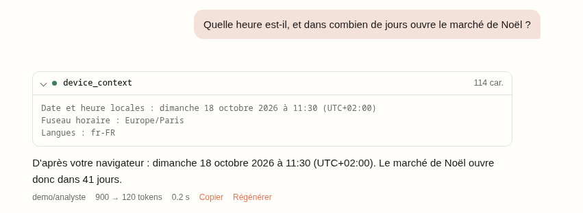

`device_context` renvoie la date et l'heure locales, le fuseau horaire,
les langues et les informations que le navigateur expose sur l'appareil :
état de connexion, type et débit réseau, batterie, préférences de thème et
de mouvement, et dimensions de la fenêtre. Les données indisponibles ne sont
pas incluses. Le modèle peut appeler cet outil avant de faire référence à
« aujourd'hui » ou pour adapter sa réponse à l'appareil. Aucune carte n'est
créée.

### Position — `get_location`

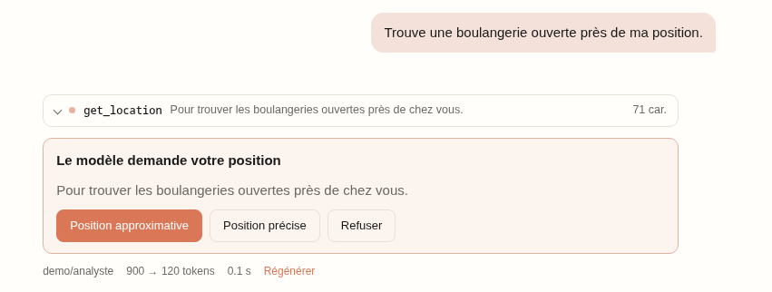

La carte affiche le motif fourni par le modèle. L'utilisateur choisit une
position **approximative** (arrondie à environ 1 km), une position
**précise**, ou refuse la demande.

### Notifications — `notify`

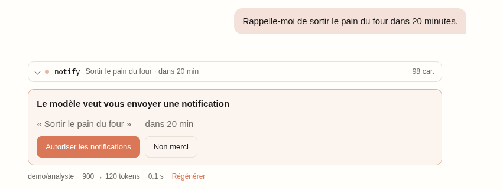

`notify` envoie une notification immédiate ou programme un rappel dans N
minutes (24 h au plus). Le rappel est émis uniquement si la page reste
ouverte. Pour un rendez-vous, utiliser l'agenda.

- Si l'autorisation du navigateur n'a pas encore été accordée, une carte la
  demande ; le navigateur ne peut demander cette autorisation qu'après un
  clic.
- Chaque notification crée une carte durable. Un rappel programmé peut être
  **annulé** ; s'il est perdu après un rechargement, il peut être
  **reprogrammé** ; une fois son heure passée, il peut être **renvoyé**.

### Presse-papiers — `clipboard_write`, `clipboard_read`

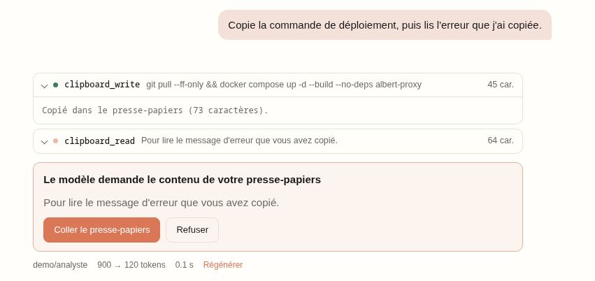

`clipboard_write` copie immédiatement une commande, une adresse ou un
message. Le texte est conservé dans une carte durable, qui permet de le
recopier. Si le navigateur refuse la copie parce que la page n'avait pas le
focus, la carte permet de lancer la copie par clic. `clipboard_read` attend
une action sur une carte, car le presse-papiers peut contenir un contenu
arbitraire.

### Agenda — `add_to_calendar`

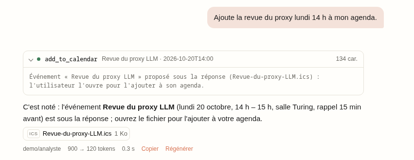

L'outil génère un événement au format `.ics` sous la réponse ; l'utilisateur
l'ouvre dans son agenda (Google, Outlook, Apple…). Les heures sont locales
et un rappel peut être défini N minutes avant. Contrairement à un rappel
par notification, l'événement reste disponible après la fermeture de la
page.

### Liens — `open_link`

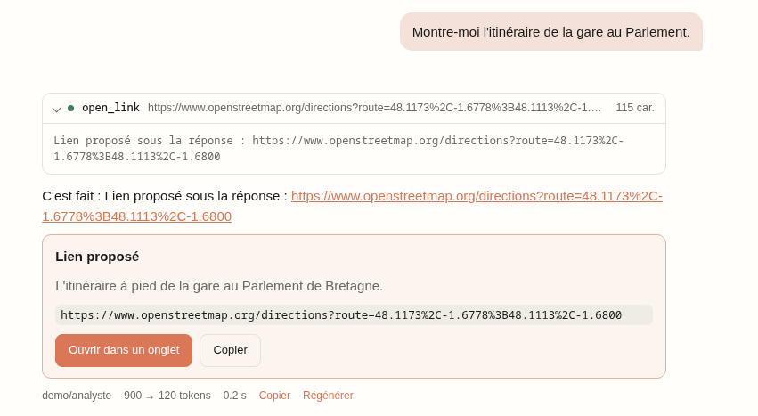

`open_link` crée une carte durable contenant une adresse http(s) complète
(itinéraire, recherche ou page de documentation). L'appel n'attend pas ;
l'utilisateur peut ouvrir l'adresse dans un nouvel onglet, la copier ou la
rouvrir plus tard. Le modèle ne reçoit pas d'information indiquant si le lien
a été ouvert.

### Partage — `share`

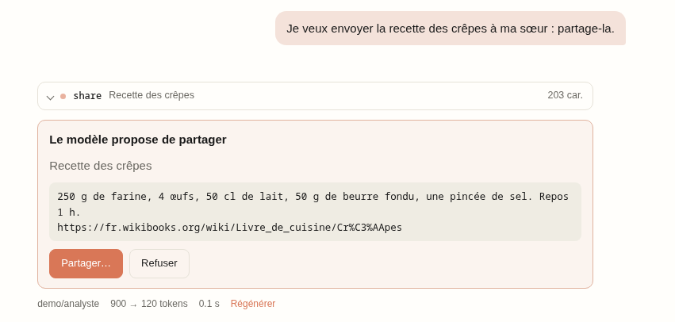

`share` crée une carte durable contenant un texte et, éventuellement, une
adresse à transmettre à une autre application (messagerie, e-mail, notes)
via le partage du système. L'appel n'attend pas ; l'utilisateur peut
partager le contenu à tout moment et autant de fois que nécessaire. Si
l'appareil ne prend pas en charge le partage (Linux ou conversation rouverte
ailleurs), la carte propose uniquement *Copier*.

### Capture d'écran — `capture_screen`

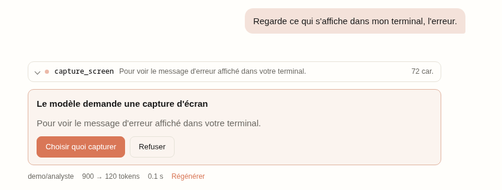

Dans le sélecteur du navigateur, l'utilisateur choisit un onglet, une
fenêtre ou l'écran entier, puis consulte l'**aperçu**. Il peut envoyer,
reprendre ou refuser la capture. L'image est jointe au résultat transmis au
modèle ; elle ne peut être interprétée que par un modèle qui prend en charge
les images.

### Caméra — `take_photo`

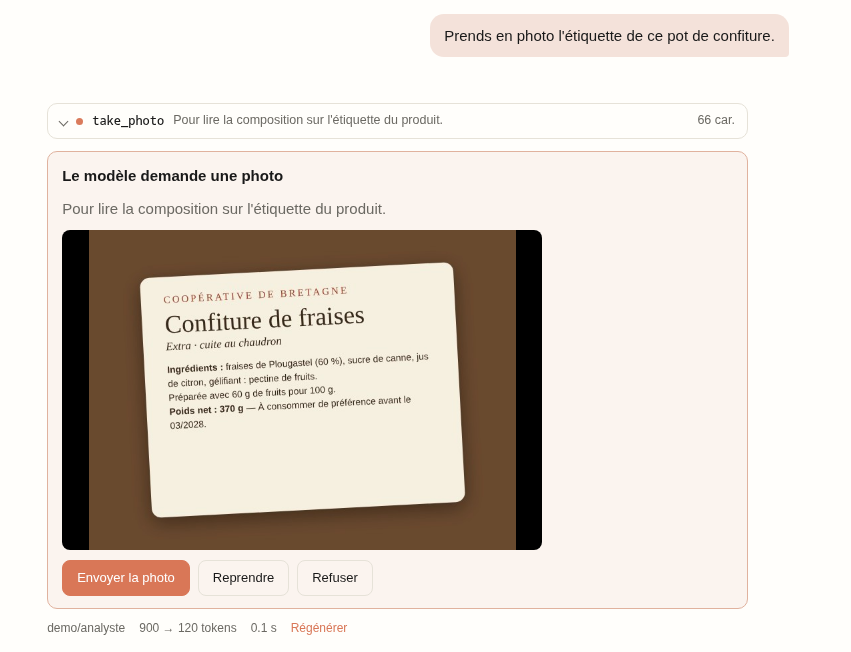

Un clic active la caméra arrière. L'utilisateur prend une photo, la vérifie
dans l'aperçu, puis l'envoie ou la reprend. La résolution est limitée à
1920 pixels par côté.

### QR et codes-barres — `scan_code`

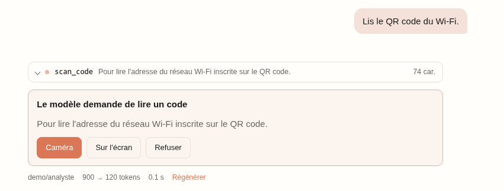

`scan_code` lit un QR code ou un code-barres depuis la caméra ou une capture
d'écran avec l'API `BarcodeDetector` (macOS, Android, ChromeOS). La carte
attend une action de l'utilisateur. Seul le **texte** décodé est transmis au
modèle, sans image ; la carte durable permet de copier le code ou d'ouvrir
son adresse s'il s'agit d'une URL.

### Pipette — `pick_color`

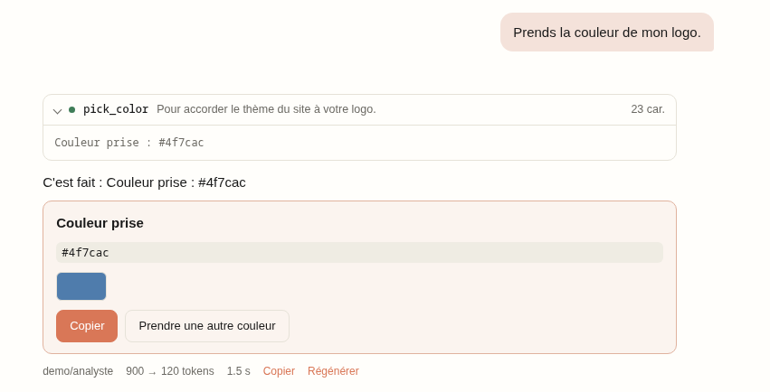

`pick_color` sélectionne une couleur n'importe où à l'écran et la renvoie
au format hexadécimal (API `EyeDropper`, Chrome et Edge). La carte durable
affiche la pastille et le code à copier ; *Prendre une autre couleur*
remplace la sélection.

### Écran allumé — `keep_screen_on`

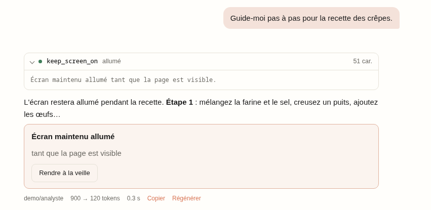

`keep_screen_on` empêche la mise en veille pendant une recette, un pas-à-pas
ou une présentation, tant que la page est visible. Le verrou est repris au
retour de la page au premier plan. La carte durable affiche l'état de l'écran
et permet de le basculer, y compris après un rechargement.

### Lecture à voix haute — `speak`

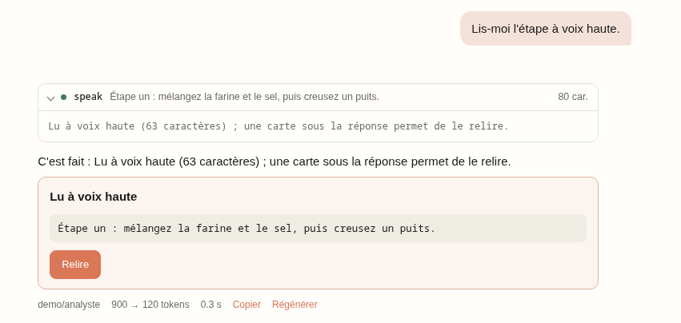

`speak` lit un texte à voix haute, par exemple une étape de procédure
mains libres ou un résumé. Le moteur est celui des *Réglages* du chat : le
navigateur ou un modèle de synthèse du proxy (voir [Chat](chat.md)). La
lecture démarre immédiatement, car l'utilisateur vient d'écrire et la page
a reçu le geste associé. La carte durable permet de **relire** le texte ou
d'**arrêter** la lecture.

La voix et le débit sont définis dans les *Réglages* du chat, comme pour
*Écouter*. Avec le moteur du navigateur, la voix choisie est utilisée si
elle parle la langue du texte ; sinon, le navigateur sélectionne une voix
dans cette langue (`lang`, voix par défaut du navigateur). Avec un modèle du
proxy, `lang` définit la langue de lecture, sauf si les réglages en
spécifient une.

## Le code dans le navigateur

Cinq outils exécutent ou vérifient du code : **JavaScript** (et
TypeScript), la **vérification de types TypeScript**, **PHP**, **SQL**
(SQLite) et **PostgreSQL**.

### Le bac

- Le code s'exécute dans un **Worker** créé dans un cadre `sandbox` sans
  origine. Il n'a accès ni à la page, ni à sa session, ni aux cookies.
- La politique de sécurité désactive **tout accès réseau** : `fetch` et
  `file_get_contents` sur une URL en PHP échouent.
- Une boucle infinie ne bloque pas la page : le bac est supprimé à
  l'expiration du délai (15 s pour JavaScript, 30 s pour PHP, 60 s pour SQL,
  PostgreSQL et la vérification TypeScript).
- PHP 8.3 (≈ 18 Mo), SQLite (≈ 700 Ko), PostgreSQL (PGlite, ≈ 17 Mo),
  Chart.js et sucrase (≈ 200 Ko chacun) ainsi que le compilateur TypeScript
  (≈ 7 Mo) sont servis par le proxy sous `/ui/static/vendor/`. Ils sont
  téléchargés au premier appel, puis revalidés par le navigateur sans être
  retéléchargés. Chaque fichier est demandé avec son empreinte (`?v=`, lue
  dans `vendor/versions.json`) afin qu'un cache devant la page ne fournisse
  pas un runtime périmé après une mise à jour.

### Fichiers fournis, fichiers produits

Le paramètre `files` désigne des chemins du **dossier ouvert** (*Joindre →
Dossier…*) ou des noms de **pièces jointes** texte du fil. La page lit ces
fichiers et les transmet au bac ; leur contenu n'est pas envoyé au modèle,
qui ne reçoit que les données renvoyées par le code.

Les fichiers produits par le code sont joints sous la réponse :

- un fichier **texte** (CSV, JSON, SVG, Markdown…) s'**ouvre en aperçu** au
  clic, comme avec `save_file` ; le Markdown est rendu, les autres formats
  sont affichés tels quels et peuvent être copiés ou téléchargés ;
- une **image** (png, jpeg, webp, gif) s'affiche. Si le modèle de la
  conversation lit les images, la première lui est jointe pour qu'il puisse
  vérifier le graphique.

Limites : dix fichiers par appel et 5 Mo par image. Les autres fichiers
binaires sont refusés.

### SQL — `run_sql`

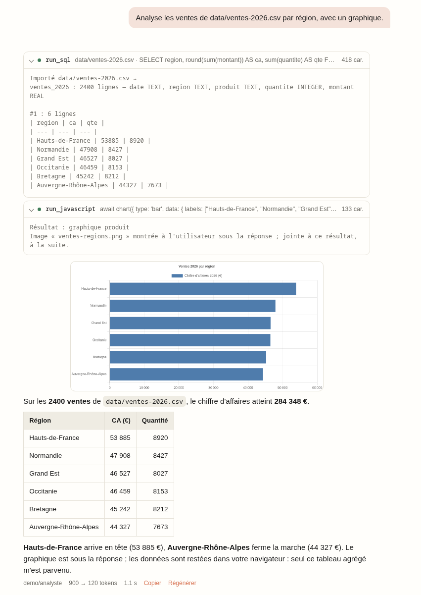

`run_sql` utilise une base **SQLite propre à la conversation**. Son état
est conservé dans ce navigateur (IndexedDB) et n'est jamais envoyé au
proxy. En navigation privée, la base reste uniquement en mémoire. La
suppression de la conversation l'efface.

`files` importe d'abord des fichiers en tables :

| Fichier | Import |
|---|---|
| `.csv`, `.tsv`, `.txt` | séparateur deviné (`,`, `;` ou tabulation), première ligne pour les noms de colonnes, types déduits (INTEGER, REAL, TEXT) ; `3,14` vaut 3.14 avec `;` ; `007` reste du texte |
| `.json`, `.jsonl` | un tableau d'objets, ou un objet par ligne ; les valeurs imbriquées sont gardées en JSON |
| `.sqlite`, `.db` | ses tables, index et vues, copiés |

- La table porte le nom du fichier, et ses colonnes ceux de l'en-tête,
  en minuscules sans accents (`Région` devient `region`).
- L'import renvoie le schéma au modèle.
- Chaque requête rend un tableau, 200 lignes au plus : le modèle agrège
  en SQL plutôt que de tout lire.

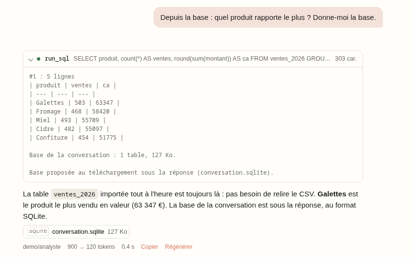

Les tables persistent entre les messages. `reset` vide la base.
`download` joint sous la réponse un fichier `conversation.sqlite`, contenant
la base telle qu'elle est au moment du clic.

### PostgreSQL — `run_postgres`

`run_postgres` exécute des requêtes **PostgreSQL 18** avec PGlite :
PL/pgSQL, JSONB, CTE récursives, fonctions fenêtres, types et `RAISE
NOTICE`. L'exécution a lieu dans le navigateur ; aucune donnée ne transite
par le proxy.

- La base est **propre à la conversation** et distincte de celle de
  `run_sql`. Son dossier de données est conservé compressé dans ce
  navigateur (IndexedDB) : ≈ 4,5 Mo pour une petite base, car PostgreSQL y
  stocke son catalogue. Rien n'est conservé tant que la base ne contient
  aucun objet de l'utilisateur. La suppression de la conversation et
  `reset` effacent la base.
- `files` importe d'abord les fichiers. CSV, TSV, JSON et JSONL sont traités
  comme avec `run_sql`, avec les mêmes noms de table et de colonnes et les
  mêmes types déduits, ici `bigint`, `double precision` ou `text`. Un fichier
  `.sql` est exécuté tel quel (schéma ou dump `INSERT`). Une base SQLite
  s'importe avec `run_sql`.
- Le script est envoyé en une requête et s'exécute dans une **transaction
  implicite**. Une erreur annule la transaction entière, sauf les opérations
  validées par un `COMMIT` explicite préalable. L'erreur contient le message
  de PostgreSQL, sa position, son détail et sa piste.
- Chaque résultat contient au plus 200 lignes.
- Un appel prend 0,5 à 1 s : la base est rechargée à chaque appel et
  PostgreSQL est compilé lors du premier.

### JavaScript — `run_javascript`

Le code constitue le corps d'une fonction `async` : `return` renvoie une
valeur et les appels à `console.log` contribuent également à la sortie.
Le code dispose des fonctions suivantes :
| Fonction | Rôle |
|---|---|
| `readText(chemin)`, `readBytes(chemin)` | lire un fichier fourni par `files` |
| `files` | tous les fichiers fournis : `{chemin: Uint8Array}` |
| `output(nom, données)` | produire un fichier : texte, objet (en JSON), `Uint8Array`, `Blob`, ou `OffscreenCanvas` (en PNG) |
| `chart(config, {width, height, name})` | dessiner un graphique Chart.js 4 : **interactif dans la réponse**, et en PNG pour le modèle (ci-dessous) ; Chart.js n'est chargé que si le code appelle `chart(` |

Le graphique SQL ci-dessus utilise `chart()`.

**Les graphiques `chart()` sont interactifs.** Ils s'affichent dans le
**corps de la réponse** sous forme de carte durable, recréée à partir de la
configuration Chart.js : valeurs au survol, légende cliquable pour masquer
une série, *Télécharger en PNG* et *Plein écran*. Après un rechargement, le
graphique est recréé à partir de la configuration conservée avec la
conversation.

- Par défaut, la carte apparaît en tête de la réponse. Le modèle peut la
  placer dans son texte avec `` sur une ligne seule ;
  le résultat de l'outil indique la syntaxe et le nombre de graphiques.
- Le modèle reçoit le PNG du premier graphique s'il lit les images, afin de
  vérifier le rendu.
- Les fonctions de la configuration, comme un formateur d'étiquettes, ne
  sont pas conservées ; la carte interactive n'en dépend pas.

Avec `language: "typescript"`, le code est du **TypeScript** : sucrase
retire les types avant l'exécution sans les vérifier. La vérification des
types est effectuée par `check_typescript`.

### TypeScript — `check_typescript`

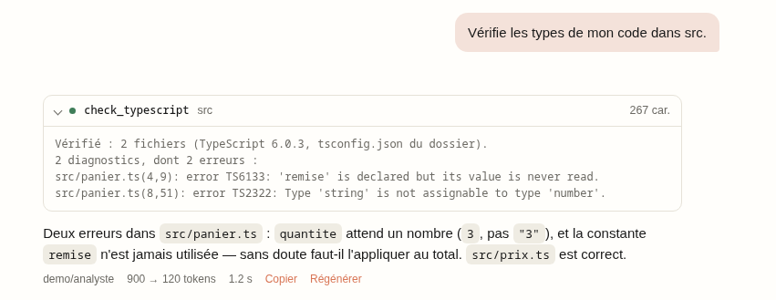

Le compilateur TypeScript 6 vérifie les types des fichiers du dossier ouvert
sans exécuter le code.

- `files` désigne les fichiers ou sous-dossiers à vérifier ; un sous-dossier
  inclut tout son contenu et `.` désigne le dossier entier.
- Tous les fichiers `.ts`, `.tsx`, `.mts` et `.cts` du dossier sont chargés
  pour résoudre les imports relatifs, mais seuls ceux désignés par `files`
  sont vérifiés.
- Le `tsconfig.json` à la racine du dossier s'applique, commentaires
  compris. En son absence, les options sont `strict`, ES2022 et modules
  ESNext.
- Aucun `node_modules` n'est disponible ; les imports de paquets sont donc
  typés `any`.
- `code` et `path` fournissent un texte à vérifier **à la place** d'un
  fichier. Le modèle peut valider une modification avant de la proposer avec
  `folder_write`.
- Le résultat liste au plus 100 erreurs au format
  `fichier(ligne,colonne): error TSxxxx: message`.

TypeScript 6.0 est la dernière version du compilateur écrite en JavaScript.
La version 7 est réécrite en Go et ne s'exécute pas dans le navigateur.

### PHP — `run_php`

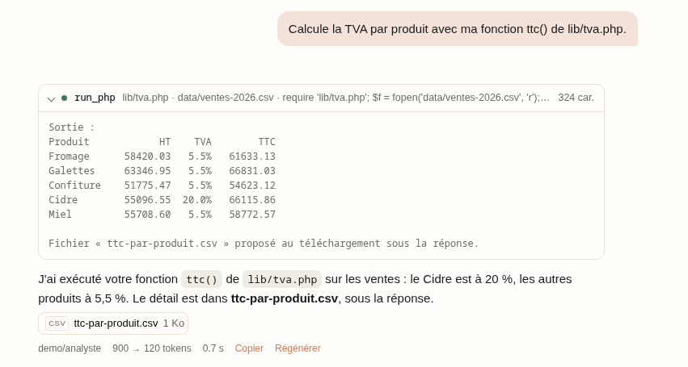

`run_php` exécute un script PHP 8.3 en ligne de commande, sans serveur
web.

- Les fichiers désignés par `files` sont copiés sous `/data`, le répertoire
  courant, en conservant leurs chemins ; `require "lib/tva.php"` fonctionne.
- Le contenu écrit sous `/out` est joint sous la réponse. GD est disponible
  pour produire des images.
- Le résultat contient la sortie (`echo`, `print_r`, `var_dump`), les
  erreurs et le code de sortie.

Chaque appel utilise un environnement neuf.

### Linux — `run_shell`


`run_shell` exécute un script bash dans une **VM Linux** (Alpine i386
émulée par v86) dans l'onglet. Le réseau est désactivé par défaut. La VM
inclut bash, busybox, python3, jq et sqlite3. `/work` est conservé par
conversation, `files` y copie les fichiers et les fichiers écrits sous
`/out` sont joints à la réponse.

Le panneau **Terminal** donne accès à la **même machine** (bouton dans
l'en-tête du chat, toujours disponible ; ouverture automatique lorsque le
modèle utilise la VM). Les outils `shell_grep`, `shell_read`, `shell_edit`
et `shell_write` permettent de modifier les fichiers comme pour un artifact.
Lorsque le panneau est ouvert, les commandes d'une ligne du modèle sont
**saisies dans le terminal** et visibles par l'utilisateur pendant leur
exécution. Le réseau peut être activé pour la conversation depuis le panneau ;
les requêtes web passent alors par le navigateur.

Voir [La VM Linux du navigateur](linux.md) pour les détails de construction,
de protocole, de paquets et de limites.

### Programmes d'outils — `run_tools_program`

La famille **Programmes d'outils**, désactivée par défaut, permet au modèle
d'écrire un court programme JavaScript qui appelle les [outils hébergés](outils-heberges.md)
activés dans la conversation et combine leurs résultats. Une recherche
suivie de plusieurs lectures peut ainsi être exécutée dans un seul appel ;
le modèle reçoit uniquement le résultat du programme, et non le contenu de
chaque page.

```js
const found = await tools.web_search({query: "release notes llama.cpp"});
const urls = [...found.matchAll(/https:\/\/\S+/g)].slice(0, 3).map((m) => m[0]);
return Promise.all(urls.map((url) =>
  tools.web_grep({url, pattern: "breaking"}).catch((e) => e.code)));
```

- Le programme s'exécute dans le [bac](#le-bac), sans réseau. `tools.<nom>`
  accepte les mêmes arguments que l'outil et renvoie son texte. En cas
  d'échec, il lève une erreur dont `code` est le [code d'erreur](outils.md#codes-derreur).
- Chaque appel passe par la page, puis par `POST /ui/tools/<nom>`. La
  session, les droits du compte et
  [`[tools].direct_calls_per_minute`](configuration.md#tools) s'appliquent.
  Seuls les outils hébergés activés dans la conversation sont accessibles
  (`memory` n'est pas accessible en navigation privée).
- Limites : 20 appels par programme, 4 appels simultanés et 120 s. Au-delà
  de 100 appels refusés, le programme est arrêté. Les appels encore en cours
  sont interrompus lorsque le programme se termine. Comme pour `/v1/tools`,
  les plafonds par réponse (`[tools].max_calls`, ceux d'`image_generation` ou
  de `code_execution`) ne s'appliquent pas ; seule la limite par minute est
  commune aux programmes.
- La [provenance des URL](outils.md#la-provenance-des-url-toolsnetprovenance)
  s'applique comme dans le reste du chat. À la fin de la réponse, le proxy
  transmet à la page les sites connus de la conversation. Chaque appel du
  programme transmet ces sites et ceux connus par ses appels précédents.
  Le résultat du programme ne fait connaître aucun site.

### Installer les runtimes

L'image Docker construit les runtimes (PHP, SQLite, PostgreSQL, Chart.js,
sucrase, TypeScript) dans l'étape `wasm` de `proxy/Dockerfile`. Hors Docker,
exécuter une fois :

```bash
cd proxy/wasm && npm ci && npm run build   # → proxy/llm_proxy/ui/web/static/vendor/
```

La VM Linux utilise un build distinct (`proxy/linux/build.sh` ; voir
[La VM Linux](linux.md)).

Sans ces runtimes, `run_php`, `run_sql`, `run_postgres` et `check_typescript`
indiquent qu'ils sont absents. `run_javascript` reste disponible, sans
`chart()` ni TypeScript.

## Écrire un outil de la page

Un outil de la page respecte le contrat commun à **tous les outils** (voir
[Écrire un outil](outils.md#écrire-un-outil)) et déclare `runs = browser` :
sa **déclaration** est dans le proxy et son **exécution** dans la page.

| Où | Contenu |
|---|---|
| `llm_proxy/tools/page/` (proxy) | les déclarations : un `BrowserTool` par outil (nom, prompt, paramètres, `settings`), une `Family` par famille du menu. `page.py` (questions, fichiers, artifacts, dossier), `device.py` (l'appareil), `sandbox.py` (les bacs de code), dans l'ordre du menu |
| `chat/tools/contract.js` | le contrat de l'exécution : les listes `TOOL` et `FAMILY`, les types, l'interface `PageTool`, `defineFamily` |
| `chat/tools/index.js` | le registre : l'inscription des modules, leur vérification, l'installation des déclarations (`install`), ce que le chat appelle |
| `chat/tools/page/`, `device/`, `sandbox/` | l'exécution, un module par famille ; `media.js`, les flux caméra et écran ; `bac.js`, le bac commun ; `files.js`, les fichiers fournis et produits ; `tables.js`, un CSV ou un JSON lu en table |

La page reçoit les déclarations via `/ui/session` (`chat.page`), qui contient
les familles et la fonction de chaque outil avec ses `settings`. Le registre
associe chaque déclaration à l'exécution de même nom. Une déclaration ou une
exécution sans correspondance est signalée dans la console et exclue du menu.
`ChatPanel.js` ne nomme aucun outil : il passe toujours par le registre.

### La déclaration (proxy)

```python
GET_LOCATION = BrowserTool(
    ToolName.GET_LOCATION,                       # de la liste fermée ToolName
    description="Demande à l'utilisateur sa position…",
    params={"reason": REASON},
    required=("reason",),
)

LOCATION_FAMILY = Family(
    FamilyKey.LOCATION, label="Position", tools=(ToolName.GET_LOCATION,),
    hint="demandée sur une carte, approximative ou précise",
)
```

Déclarer dans `settings` les valeurs citées dans le prompt et appliquées par
l'exécution (par exemple une limite ou un délai). Définies une fois côté
proxy, elles sont transmises à la page avec la déclaration (`this.settings`
de l'outil). Les textes des outils de la page sont en français.

| `Family` | Rôle |
|---|---|
| `key` | sa clé, de la liste fermée `FamilyKey` |
| `label`, `hint` | ce qu'affiche le menu Outils |
| `tools` | les noms de ses outils |
| `on` | cochée d'office dans une conversation neuve |
| `fixed` | toujours active, hors du menu (questions, fichiers, artifacts, dossier) |
| `authored` | ses résultats sont écrits par le modèle ou son code (les bacs, les artifacts) : ils ne font connaître aucun site au proxy ([provenance](outils.md#la-provenance-des-url-toolsnetprovenance)) |
| `guidance` | une consigne ajoutée au **prompt système** quand la famille est active ; **figée**, elle ne dépend pas de l'état |

### L'exécution : `PageTool`

Un outil est une **classe** qui hérite de `PageTool`. Son constructeur
transmet son nom à la classe de base. Les méthodes de l'interface sont
redéfinies et marquées `@override` :

```js
class GetLocation extends PageTool {
  constructor() {
    super({ name: TOOL.GET_LOCATION });        // de la liste fermée TOOL
  }
  /** @override */ waits() { return true; }                   // une carte
  /** @override */ prepare(args) { return reasonOf(args); }   // l'état de la carte
  /** @override */ view(w) { return { title: "…", actions: […] }; }
  /** @override */ act(w, action, ctx) { return { result: "…" }; }
  /** @override */ summary(a) { return a.reason; }            // la puce de l'appel
}
```

| Membre | Rôle | Défaut |
|---|---|---|
| `super({name})` | nom de l'outil, identique à celui de sa déclaration | — |
| `placement`, `component` (dans `super`) | emplacement de la carte (fil ou feuille du bas) et composant Vue optionnel à la place du gabarit commun | fil, gabarit commun |
| `settings` | valeurs déclarées avec l'outil (`max_rows`, `timeout`…), définies à l'installation | `{}` |
| `run(args, ctx)` | exécution immédiate ; renvoie un texte ou `{result, image?, artifact?, keep?}` | — |
| `waits(args, ctx)` | indique si l'outil attend une action de l'utilisateur | non |
| `prepare(args, ctx)` | renvoie l'état initial de la carte ou `{error}` | `{}` |
| `view(w)` | renvoie le contenu de la carte : titre, détail, boutons, aperçu, flux vidéo ou citation | — |
| `act(w, action, ctx, payload)` | traite une action de bouton ; renvoie `{result, image?, keep?}` quand la carte est répondue, `null` si elle reste en attente ; les erreurs levées sont affichées | — |
| `release(w)` | libère les ressources à la fermeture de la carte, par exemple la caméra ou l'écran | rien |
| `abandoned(w)` | résultat associé à une carte abandonnée sans réponse | « L'utilisateur n'a pas répondu… » |
| `notice(w)`, `pending(w)` | texte de la notification et ligne qui rouvre la feuille | titre de la carte |
| `keptView(k)`, `keptAct(k, action, ctx)` | rendu et actions d'une carte **durable**, créée par un `run` qui renvoie `{result, keep}` (`keep` peut contenir une carte ou une liste) ; les actions sont rejouables sans nouvel envoi au modèle | aucune |
| `keptComponent` (dans `super`) | composant Vue d'une carte durable à la place de `keptView` ; avec un `slot`, place la carte **dans le texte** (``), sinon en tête | gabarit commun, sous la réponse |
| `summary(args)` | texte affiché dans la puce d'appel du fil | vide |
| `fileContent(ref)` | contenu relu au clic d'un fichier produit avec `source: {tool, ref}` | aucun |
| `forget(convId)` | efface les données conservées pour une conversation supprimée | rien |

`ctx` fournit le contexte du tour : conversation, message, dossier ouvert,
`vision` (capacité du modèle à lire les images) et `download`.

Les API du navigateur utilisent VueUse. `tools/device/vueuse.js` initialise
les composables une seule fois dans une portée liée à la durée de vie de la
page (`useClipboard`, `useShare`, `useEyeDropper`, `useWakeLock`,
`useSpeechSynthesis`…). Les composables de caméra et d'écran sont initialisés
pour chaque carte (`useUserMedia`, `useDisplayMedia`).

`defineFamily({...})` associe l'exécution des outils d'une famille aux
informations dépendant du navigateur ou du tour :

| Clé | Rôle |
|---|---|
| `key` | clé de la déclaration, choisie dans la liste fermée `FAMILY` |
| `tools` | instances des outils (`new GetLocation()`…) |
| `available()` | indique si le navigateur prend en charge la famille |
| `enabled(ctx)` | indique si la famille est active pour le tour, selon le choix de l'utilisateur (par exemple, si le dossier est ouvert), et non selon l'état de la conversation |
| `state(ctx)` | état courant (artifacts et version, dossier ouvert, réseau de la VM), joint au message de l'utilisateur du tour lorsqu'il change |

Le module exporte `FAMILIES` et s'inscrit **une fois** dans `MODULES` de
`tools/index.js`. Les outils de page fournis par une extension suivent la
même interface : voir [Extensions](extensions.md#le-js).

### L'historique, en ajout seul

Chaque requête conserve le préfixe de la précédente — mêmes outils, même
prompt système et mêmes messages passés tels qu'ils ont été envoyés — puis
ajoute les nouveaux messages. Les caches de préfixe des backends (llama.cpp,
gufo, Anthropic) et la réflexion signée d'Anthropic ne réutilisent que ce
préfixe identique.

- Le prompt système, le résumé et les `guidance` restent inchangés d'un tour
  à l'autre.
- Les outils changent uniquement selon les choix de l'utilisateur (menu
  Outils, dossier ouvert). Les outils de débogage des artifacts restent
  toujours déclarés et répondent même lorsqu'ils n'ont rien à faire.
- L'état des outils (`state`) est fixé au moment où le message de
  l'utilisateur est envoyé (`state` dans la conversation). Il est joint au
  message s'il diffère du précédent (« [État du moment, ajouté par la
  page] »), puis rejoué à l'identique.
- Un appel passé est rejoué tel qu'il a été enregistré, même si son contenu
  est périmé (artifact retouché, fichier réécrit). La consigne précise que
  seule la version actuelle compte (`read_artifact`, `shell_read`). Le
  compactage du résumé reste le moyen de réduire l'historique.

Mesure sur une conversation avec artifact (Claude Haiku 5.5, la page puis
deux retouches) : la première requête de chaque nouveau tour lisait 0 % de
son prompt dans le cache, car la liste des artifacts modifiait le prompt
système et l'historique raccourcissait les anciens contenus. Elle en lit
maintenant 98 %.

### Les garde-fous

Le contrat des outils est vérifié à plusieurs niveaux :

- **Le proxy**, au démarrage, refuse une déclaration hors contrat (un
  `run` Python sur un outil du navigateur, un nom hors de `ToolName`, une
  famille sans outil…), et exige que chaque nom de `ToolName` et chaque
  clé de `FamilyKey` soit déclaré.
- **Le registre de la page**, au chargement, refuse :
  - un outil qui n'hérite pas de `PageTool` ;
  - un membre que l'interface ne déclare pas : `sumary()` au lieu de
    `summary()`, ou une aide rangée dans la classe au lieu d'une
    fonction du module ;
  - un mode incohérent : une carte sans `act`, un outil sans `run` ni
    carte ;
  - un nom de `TOOL` ou une clé de `FAMILY` sans exécution, ou exécuté
    deux fois.
- **Déclarations et exécution ensemble** : pytest donne les déclarations
  du proxy à `proxy/wasm/check-tools.mjs`, qui exige une exécution pour
  chacune et une déclaration pour chaque exécution native.
- **TypeScript** vérifie les modules, tous en `// @ts-check`. Un
  `@override` sur une méthode que `PageTool` n'a pas, une clé inconnue
  dans `super({...})` ou une carte qui rend `{resultat}` au lieu de
  `{result}` sont des erreurs.
- **Les tests de la logique pure** (`proxy/wasm/tests/*.test.mjs`,
  `node --test`) : le rendu Markdown sûr, le document d'un artifact et
  sa capture, l'enregistrement des conversations (avec le vrai Vue et un
  proxy simulé), les messages d'une requête (chat/api.js, « ajout seul »),
  les tours d'outils (chat/turn.js) et l'installation des déclarations
  (tools/index.js). `npm test` les lance seuls.
- **`npm run check`** lance TypeScript, l'exécution chargée par Node
  (`check-tools.mjs`, sans les déclarations), puis les tests. pytest le
  lance aussi, avec les déclarations ; le test est ignoré sans Node.

```bash
cd proxy/wasm && npm ci && npm run check
```
