# Les outils du navigateur

Dans le [chat](chat.md) de la page, le modèle peut solliciter
l'**appareil** de l'utilisateur : son heure, sa position, son
presse-papiers, sa caméra, son écran. Il peut aussi faire tourner du
**code** (JavaScript, TypeScript, PHP, SQL) dans un bac isolé du
navigateur, sur des fichiers qui ne quittent pas l'appareil.

Ces outils ne passent pas par le proxy. Il les rend au navigateur en
`tool_calls`, comme à tout client : la page les exécute et renvoie leur
résultat au modèle.

Cette page présente chaque outil avec un exemple réel. Les captures ont
été prises dans la page, avec un modèle de démonstration qui appelle les
outils ; les résultats affichés sont ceux qu'ils ont vraiment rendus.

## Activer les outils


Les outils sont rangés par **famille**, dans la section *Navigateur* du
menu **Outils**. On les coche par conversation, et une conversation
neuve reprend le dernier choix fait dans ce navigateur.

- Seules les familles que le navigateur sait faire sont proposées : pas
  de *Partage* sous Linux, pas de *Pipette* hors Chrome et Edge, pas de
  *QR et codes-barres* hors macOS, Android et ChromeOS.
- Seules les familles cochées sont déclarées au modèle, car chaque outil
  coûte des tokens à chaque requête.
- Cochées d'office : Date et heure, Notifications, Presse-papiers,
  Agenda, Liens.
- Un modèle qui tourne dans le navigateur (Gemini Nano) ne reçoit pas
  ces outils.

Les API du navigateur passent par [VueUse](https://vueuse.org)
(`static/vueuse.iife.min.js`, chargé avec Vue) : presse-papiers,
partage, pipette, verrou d'écran, caméra et écran, synthèse vocale,
réseau, batterie.

## Deux sortes de cartes

**Une carte qui attend.** Ce qui touche à l'appareil n'est **jamais** lu
sans un clic de l'utilisateur. Le modèle n'obtient pas la position, le
presse-papiers, une photo ou une capture parce que la permission du
navigateur est déjà accordée : une carte apparaît dans le fil, avec la
raison donnée par le modèle, et la réponse attend.

- Répondue, la carte devient le résultat de l'outil, et la réponse du
  modèle reprend.
- Refusée, le modèle lit « L'utilisateur a refusé… » et s'adapte.
- Une nouvelle question pendant qu'une carte attend la ferme sans
  réponse.
- La caméra et l'écran sont coupés dès que la carte est répondue ou
  abandonnée.
- Tout l'état est dans le message : une carte survit à un rechargement
  de la page.

**Une carte durable.** Ce qui reste utile après la réponse laisse une
carte **sous la réponse**, que l'utilisateur rejoue quand il veut :
partager, rouvrir un lien, recopier un texte, reprendre une couleur,
rallumer l'écran, annuler un rappel, relire un texte. Elle est gardée
avec la conversation et revient après un rechargement. Ses boutons
n'envoient plus rien au modèle : la réponse est finie.

| Outil | Carte qui attend | Carte durable |
|---|---|---|
| `get_location` | oui | — |
| `notify` | si la permission manque | le rappel : *Annuler*, *Le reprogrammer*, *Renvoyer* |
| `clipboard_write` | — | le texte : *Copier* |
| `clipboard_read` | oui | — |
| `open_link` | — | l'adresse : *Ouvrir dans un onglet*, *Copier* |
| `share` | — | le texte : *Partager…*, *Copier* |
| `capture_screen`, `take_photo` | oui (aperçu) | — (l'image reste sous la réponse) |
| `scan_code` | oui | le code : *Copier*, *Ouvrir l'adresse* |
| `pick_color` | oui | la pastille : *Copier*, *Prendre une autre couleur* |
| `keep_screen_on` | — | l'état de l'écran : le basculer |
| `speak` | — | le texte : *Relire*, *Arrêter* |

Les autres outils (date, agenda, code) s'exécutent aussitôt.

## Les outils un par un

### Date et heure — `device_context`

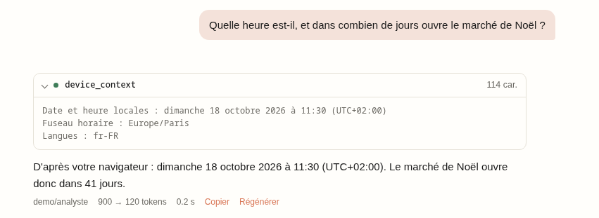

La date et l'heure locales, le fuseau horaire et les langues, et ce que
le navigateur dit de l'appareil : en ligne ou non, le type et le débit
de la connexion, la batterie, le thème et le mouvement préférés, la
taille de la fenêtre. Ce que le navigateur ne sait pas n'est pas dit. Le
modèle l'appelle avant de parler d'« aujourd'hui », ou pour adapter sa
réponse à l'appareil. Pas de carte.

### Position — `get_location`

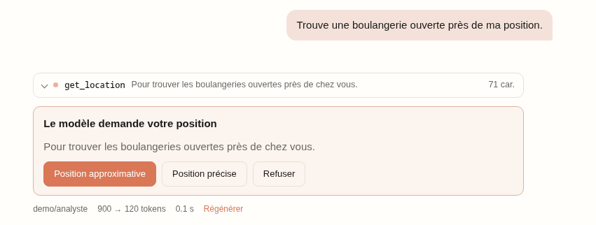

Le modèle donne la raison, montrée sur la carte. L'utilisateur choisit :
**approximative** (arrondie à environ 1 km), **précise**, ou refus.

### Notifications — `notify`

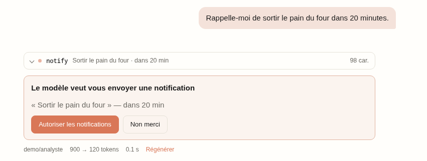

Une notification tout de suite, ou un rappel dans N minutes (24 h au
plus). Le rappel n'arrive que si la page reste ouverte ; pour un
rendez-vous, l'agenda vaut mieux.

- Si le navigateur n'a pas encore la permission, une carte la demande
  d'abord, puisqu'il ne la demande que sur un clic.
- Chaque notification laisse une carte durable. Un rappel programmé
  s'**annule** ; perdu par un rechargement, il se **reprogramme** ;
  passé, il se **renvoie**.

### Presse-papiers — `clipboard_write`, `clipboard_read`

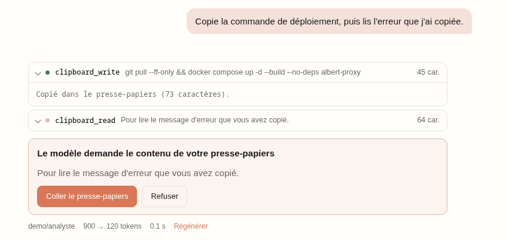

**Copier** se fait aussitôt : une commande, une adresse, un message à
coller ailleurs. Le texte reste en carte durable, à recopier. Si le
navigateur refuse la copie (la page n'avait pas le focus), la carte
permet de copier d'un clic. **Lire** passe par une carte qui attend, car
le presse-papiers peut contenir n'importe quoi.

### Agenda — `add_to_calendar`

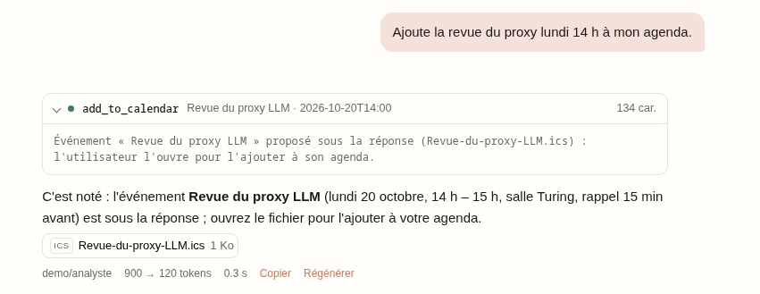

Un événement au format `.ics` sous la réponse, que l'utilisateur ouvre
dans son agenda (Google, Outlook, Apple…). Les heures sont locales ; un
rappel N minutes avant est possible. Contrairement à un rappel par
notification, le rendez-vous survit à la page.

### Liens — `open_link`

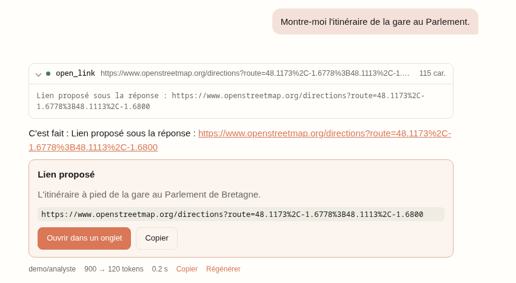

Une adresse http(s) à ouvrir dans un nouvel onglet : un itinéraire, une
recherche, une page de documentation. L'appel n'attend pas : il laisse
une carte durable où l'adresse se lit **en entier**, à ouvrir quand on
veut, et à rouvrir plus tard. Le modèle ne sait pas si elle a été
ouverte.

### Partage — `share`

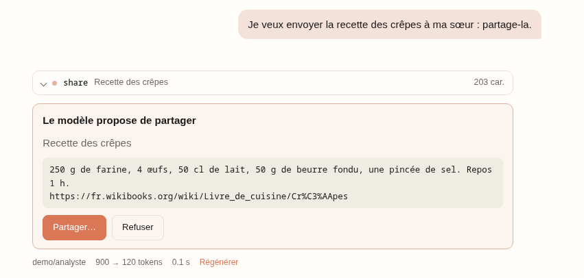

Un texte, et éventuellement une adresse, à envoyer vers une autre
application (messagerie, mail, notes) par le partage du système. L'appel
n'attend pas : il laisse une carte durable, que l'utilisateur partage
quand il veut, et autant de fois qu'il veut. Sur un appareil sans
partage (Linux, ou la conversation rouverte ailleurs), elle propose
seulement *Copier*.

### Capture d'écran — `capture_screen`

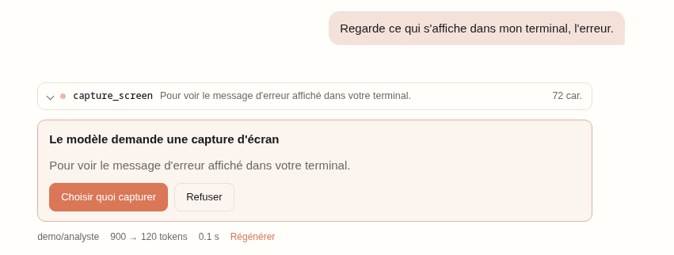

L'utilisateur choisit un onglet, une fenêtre ou l'écran entier dans le
sélecteur du navigateur, voit l'**aperçu**, puis envoie, reprend ou
refuse. L'image part au modèle jointe au résultat : il faut un modèle
qui lit les images.

### Caméra — `take_photo`

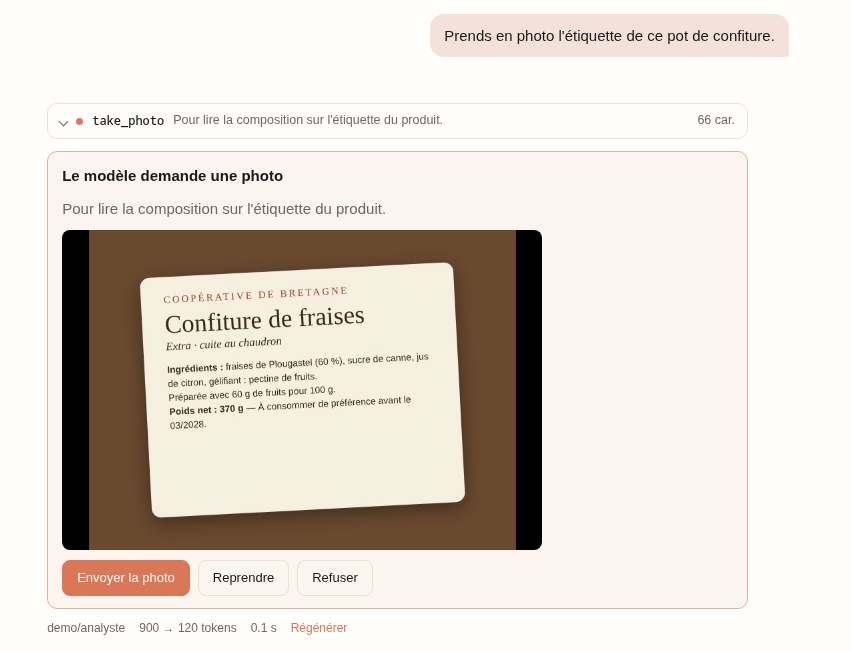

La caméra arrière s'active sur un clic. L'utilisateur prend la photo, la
vérifie en aperçu, puis l'envoie ou la reprend. L'image est réduite à
1920 pixels de côté au plus.

### QR et codes-barres — `scan_code`

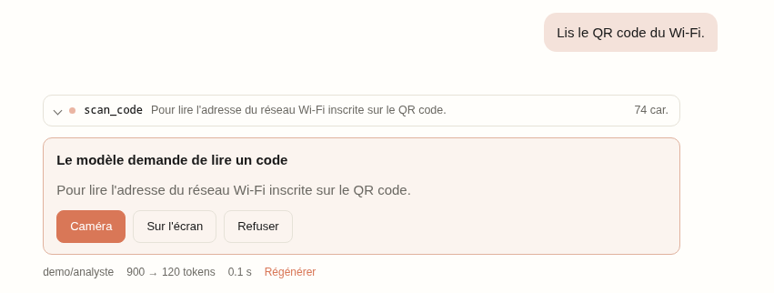

Un QR code ou un code-barres lu à la caméra ou sur une capture d'écran
(API `BarcodeDetector` : macOS, Android, ChromeOS), sur une carte qui
attend. Seul le **texte** lu part au modèle, pas d'image. Le code reste
en carte durable : à copier, ou à ouvrir si c'est une adresse.

### Pipette — `pick_color`

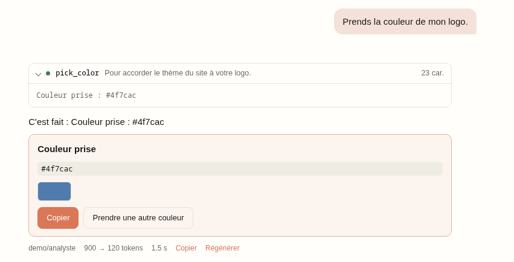

Une couleur prise n'importe où à l'écran, rendue en hexadécimal (API
`EyeDropper` : Chrome et Edge). La carte durable montre la pastille et
le code, à copier ; *Prendre une autre couleur* la remplace.

### Écran allumé — `keep_screen_on`

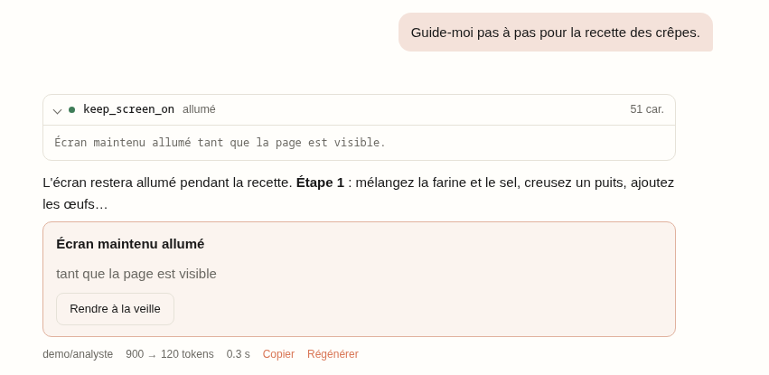

Empêche la mise en veille pendant une recette, un pas-à-pas ou une
présentation, tant que la page est visible ; le verrou est repris quand
la page revient au premier plan. La carte durable montre l'état de
l'écran et le bascule, après un rechargement aussi.

### Lecture à voix haute — `speak`

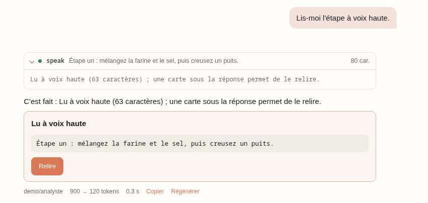

Le navigateur lit un texte avec sa synthèse vocale : une étape d'un
pas-à-pas mains libres, un résumé à écouter. La lecture part aussitôt
(l'utilisateur vient d'écrire, la page a eu son geste) ; la carte
durable permet de **relire**, ou d'**arrêter** pendant la lecture. La
voix et le débit sont ceux choisis dans les *Réglages* du chat (ceux
d'*Écouter*), si la voix parle la langue du texte ; sinon une voix de
cette langue (`lang`, celle du navigateur par défaut).

## Le code dans le navigateur

Quatre outils exécutent ou vérifient du code : **JavaScript** (et
TypeScript), la **vérification de types TypeScript**, **PHP** et **SQL**.

### Le bac

- Le code tourne dans un **Worker**, créé dans un cadre `sandbox` sans
  origine : il n'a accès ni à la page, ni à sa session, ni à ses
  cookies.
- Une politique de sécurité coupe **tout réseau** : `fetch`, ou
  `file_get_contents` sur une URL en PHP, échouent.
- Une boucle sans fin ne fige pas la page : le bac est supprimé au délai
  dépassé (15 s pour JavaScript, 30 s pour PHP, 60 s pour SQL et pour
  la vérification TypeScript).
- PHP 8.3 (≈ 18 Mo), SQLite (≈ 700 Ko), Chart.js et sucrase (≈ 200 Ko
  chacun) et le compilateur TypeScript (≈ 7 Mo) sont servis par le proxy sous `/ui/static/vendor/`. Ils ne sont téléchargés
  qu'au premier appel, puis revalidés par le navigateur sans être
  retéléchargés.

### Fichiers fournis, fichiers produits

Ces outils prennent un paramètre `files` : des chemins du
**dossier ouvert** (*Joindre → Dossier…*) ou des noms de **pièces
jointes** texte du fil. La page lit ces fichiers et les passe au bac :
ils ne partent pas au modèle, qui ne reçoit que ce que son code
renvoie.

Ce que le code produit arrive sous la réponse :

- un fichier **texte** (CSV, JSON, SVG, Markdown…) se télécharge, comme
  avec `save_file` ;
- une **image** (png, jpeg, webp, gif) s'affiche. Si le modèle de la
  conversation lit les images, la première lui est jointe : il peut
  vérifier son graphique.

Dix fichiers au plus par appel, et 5 Mo par image. Les autres binaires
sont refusés.

### SQL — `run_sql`

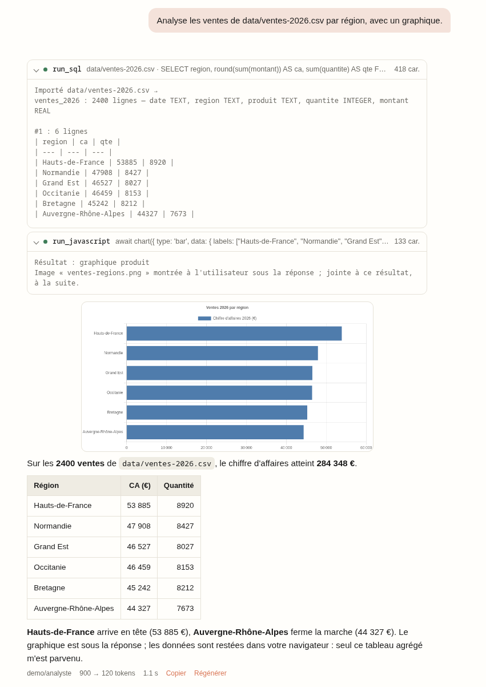

`run_sql` travaille sur une base **SQLite propre à la conversation**.
Elle est gardée dans ce navigateur (IndexedDB) et jamais envoyée au
proxy. En incognito, elle reste en mémoire seulement. Elle est effacée
avec la conversation.

`files` importe d'abord des fichiers en tables :

| Fichier | Import |
|---|---|
| `.csv`, `.tsv`, `.txt` | séparateur deviné (`,`, `;` ou tabulation), première ligne pour les noms de colonnes, types déduits (INTEGER, REAL, TEXT) ; `3,14` vaut 3.14 avec `;` ; `007` reste du texte |
| `.json`, `.jsonl` | un tableau d'objets, ou un objet par ligne ; les valeurs imbriquées sont gardées en JSON |
| `.sqlite`, `.db` | ses tables, index et vues, copiés |

- La table porte le nom du fichier, et ses colonnes ceux de l'en-tête,
  en minuscules sans accents (`Région` devient `region`).
- L'import renvoie le schéma au modèle.
- Chaque requête rend un tableau, 200 lignes au plus : le modèle agrège
  en SQL plutôt que de tout lire.

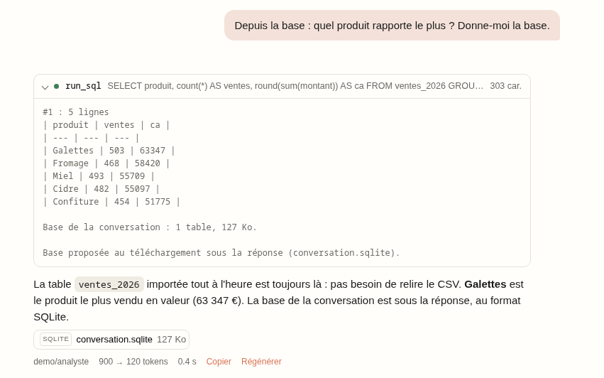

Les tables restent d'un message à l'autre. `reset` vide la base.
`download` met sous la réponse un fichier `conversation.sqlite`, avec la
base telle qu'elle est au moment du clic.

### JavaScript — `run_javascript`

Le code est le corps d'une fonction `async` : `return` rend une valeur,
et la sortie de `console.log` est rendue aussi. Le code dispose de :

| Fonction | Rôle |
|---|---|
| `readText(chemin)`, `readBytes(chemin)` | lire un fichier fourni par `files` |
| `files` | tous les fichiers fournis : `{chemin: Uint8Array}` |
| `output(nom, données)` | produire un fichier : texte, objet (en JSON), `Uint8Array`, `Blob`, ou `OffscreenCanvas` (en PNG) |
| `chart(config, {width, height, name})` | dessiner un graphique Chart.js 4 en PNG, sur fond blanc ; Chart.js n'est chargé que si le code appelle `chart(` |

Le graphique de la section SQL ci-dessus est un appel à `chart()`.

Avec `language: "typescript"`, le code est du **TypeScript** : sucrase
en retire les types avant l'exécution, sans les vérifier (c'est le rôle
de `check_typescript`, ci-dessous).

### TypeScript — `check_typescript`

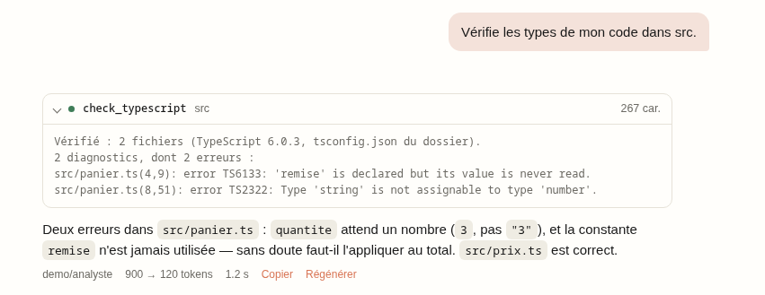

Le compilateur TypeScript 6 vérifie les types de fichiers du dossier
ouvert, sans rien exécuter.

- `files` désigne ce qui est vérifié : des fichiers, ou des
  sous-dossiers (tout ce qu'ils contiennent) ; `.` désigne tout le
  dossier.
- Les `.ts`, `.tsx`, `.mts` et `.cts` du dossier sont tous chargés, pour
  résoudre les imports relatifs ; seuls ceux de `files` sont vérifiés.
- Le `tsconfig.json` à la racine du dossier s'applique, commentaires
  compris. Sans lui : `strict`, ES2022, modules ESNext.
- Il n'y a pas de `node_modules` : un import de paquet vaut `any`.
- `code` et `path` vérifient un texte **à la place** d'un fichier : le
  modèle contrôle une modification avant de la proposer avec
  `folder_write`.
- Le résultat liste les erreurs au format
  `fichier(ligne,colonne): error TSxxxx: message`, 100 au plus.

Le compilateur est le dernier écrit en JavaScript (TypeScript 6.0) : la
version 7 est réécrite en Go et ne tourne pas dans le navigateur.

### PHP — `run_php`

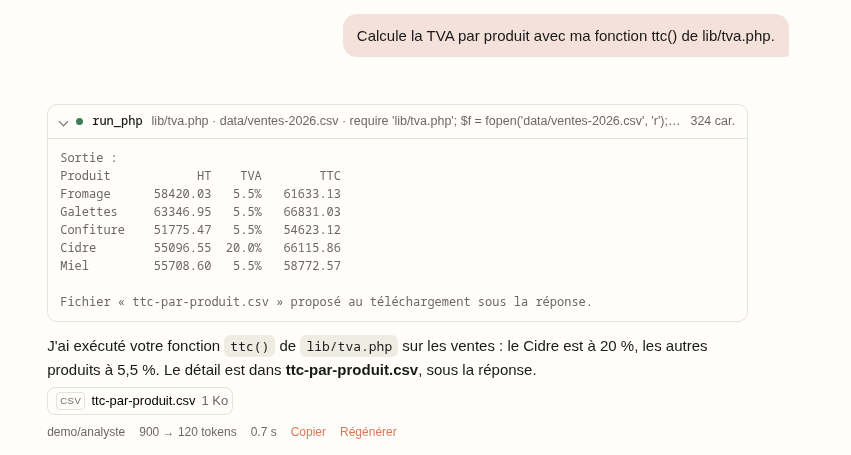

Un script PHP 8.3 en ligne de commande, sans serveur web.

- Les fichiers de `files` sont copiés sous `/data`, qui est le dossier
  courant, avec leurs chemins : `require "lib/tva.php"` fonctionne.
- Ce que le script écrit sous `/out` est rendu sous la réponse. GD est
  présent pour produire des images.
- Le résultat donne la sortie (`echo`, `print_r`, `var_dump`), les
  erreurs et le code de sortie.

Chaque appel repart de zéro.

### Installer les runtimes

L'image Docker construit les runtimes (PHP, SQLite, Chart.js, sucrase,
TypeScript) dans l'étape `wasm` de `proxy/Dockerfile`. Hors Docker, il faut les construire une fois :

```bash
cd proxy/wasm && npm ci && npm run build   # → proxy/llm_proxy/web/static/vendor/
```

Sans eux, `run_php`, `run_sql` et `check_typescript` répondent que le
runtime manque. `run_javascript` fonctionne toujours, mais sans
`chart()` ni TypeScript.

## Écrire un outil de la page

Tous les outils que la page exécute suivent la même **interface** :
ceux du navigateur, et aussi la question à choix (`ask_user`),
`save_file`, les artifacts et le dossier ouvert. Ils sont rangés dans
`chat/tools/` :

| Dossier | Contenu |
|---|---|
| `tools/contract.js` | le contrat : les listes `TOOL` et `FAMILY`, les types, l'interface `PageTool`, `defineFamily` |
| `tools/index.js` | le registre : l'inscription des modules, leur vérification, ce que le chat appelle |
| `tools/page/` | questions (`ask.js`), fichiers (`save.js`), artifacts, dossier ouvert (`folder.js`) |
| `tools/device/` | l'appareil, un module par famille ; `media.js`, les flux caméra et écran |
| `tools/sandbox/` | les bacs de code ; `bac.js`, le bac commun ; `files.js`, les fichiers fournis et produits |

Le chat (`ChatPanel.js`) ne nomme aucun outil : il passe toujours par
le registre.

### L'interface `PageTool`

Un outil est une **classe** qui hérite de `PageTool`. Son constructeur
passe ce qu'il déclare ; ses méthodes réécrivent celles de l'interface,
chacune marquée `@override` :

```js
class GetLocation extends PageTool {
  constructor() {
    super({
      name: TOOL.GET_LOCATION,               // de la liste fermée TOOL
      description: "Demande à l'utilisateur sa position…",
      params: { reason: { type: "string", description: "Pourquoi…" } },
      required: ["reason"],
    });
  }
  /** @override */ waits() { return true; }                   // une carte
  /** @override */ prepare(args) { return reasonOf(args); }   // l'état de la carte
  /** @override */ view(w) { return { title: "…", actions: […] }; }
  /** @override */ act(w, action, ctx) { return { result: "…" }; }
  /** @override */ summary(a) { return a.reason; }            // la puce de l'appel
}
```

| Membre | Rôle | Défaut |
|---|---|---|
| `super({name, description, params, required})` | ce que le modèle lit : le nom (de `TOOL`), la description, les paramètres | — |
| `placement`, `component` (dans `super`) | une carte dans le fil ou dans la feuille du bas ; un composant Vue à la place du gabarit commun | dans le fil, gabarit commun |
| `run(args, ctx)` | l'exécution, aussitôt : un texte, ou `{result, image?, artifact?, keep?}` | — |
| `waits(args, ctx)` | attend-il l'utilisateur ? | non |
| `prepare(args, ctx)` | l'état de la carte, ou `{error}` | `{}` |
| `view(w)` | ce que la carte montre : titre, détail, boutons, aperçu, flux vidéo, citation | — |
| `act(w, action, ctx, payload)` | un bouton : `{result, image?, keep?}` quand la carte est répondue, `null` si elle attend encore ; une erreur levée s'affiche | — |
| `release(w)` | la carte est fermée : couper la caméra, l'écran | rien |
| `abandoned(w)` | le résultat d'une carte laissée sans réponse | « L'utilisateur n'a pas répondu… » |
| `notice(w)`, `pending(w)` | le texte de la notification ; la ligne qui rouvre la feuille | le titre de la carte |
| `keptView(k)`, `keptAct(k, action, ctx)` | une carte **durable**, laissée sous la réponse par un `run` qui rend `{result, keep}` : ce qu'elle montre, et ses boutons, rejouables à volonté (rien ne part plus au modèle) | aucune |
| `summary(args)` | la ligne de la puce de l'appel dans le fil | vide |
| `fileContent(ref)` | le contenu, relu au clic, d'un fichier produit avec `source: {tool, ref}` | aucun |
| `forget(convId)` | la conversation est supprimée : effacer ce que l'outil garde pour elle | rien |

`ctx` donne au tour la conversation, le message, le dossier ouvert,
`vision` (le modèle lit-il les images ?) et `download`.

Les API du navigateur passent par VueUse : `tools/device/vueuse.js` crée
ses composables une fois, dans une portée qui vit autant que la page
(`useClipboard`, `useShare`, `useEyeDropper`, `useWakeLock`,
`useSpeechSynthesis`…) ; la caméra et l'écran ont la leur, par carte
(`useUserMedia`, `useDisplayMedia`).

### La famille

`defineFamily({...})` regroupe les outils d'un module :

| Clé | Rôle |
|---|---|
| `key` | sa clé, de la liste fermée `FAMILY` |
| `label`, `hint` | ce qu'affiche le menu Outils |
| `on` | cochée d'office dans une conversation neuve |
| `fixed` | toujours active, hors du menu (questions, fichiers, artifacts, dossier) |
| `available()` | ce navigateur sait-il la faire ? |
| `enabled(ctx)` | active pour ce tour ? (le dossier : s'il est ouvert) |
| `guidance(ctx)` | une consigne ajoutée au **prompt système** quand la famille est active |
| `tools` | ses outils (`new GetLocation()`…) |

Le module exporte `FAMILIES`, et s'inscrit **une fois** dans la liste
`MODULES` de `tools/index.js`.

### Les garde-fous

Trois vérifications empêchent les dérives :

- **Le registre**, au chargement de la page, refuse :
  - un outil qui n'hérite pas de `PageTool` ;
  - un membre que l'interface ne déclare pas : `sumary()` au lieu de
    `summary()`, ou une aide rangée dans la classe au lieu d'une
    fonction du module ;
  - un mode incohérent : une carte sans `act`, un outil sans `run` ni
    carte, un paramètre requis absent de `params` ;
  - un nom de `TOOL` ou une clé de `FAMILY` sans implémentation, ou
    implémenté deux fois.
- **TypeScript** vérifie les modules, tous en `// @ts-check`. Un
  `@override` sur une méthode que `PageTool` n'a pas, une clé inconnue
  dans `super({...})` ou une carte qui rend `{resultat}` au lieu de
  `{result}` sont des erreurs.
- **`npm run check`** lance les deux hors du navigateur : TypeScript,
  puis le registre chargé par Node (`proxy/wasm/check-tools.mjs`).
  pytest le lance aussi ; le test est ignoré sans Node.

```bash
cd proxy/wasm && npm ci && npm run check
```
