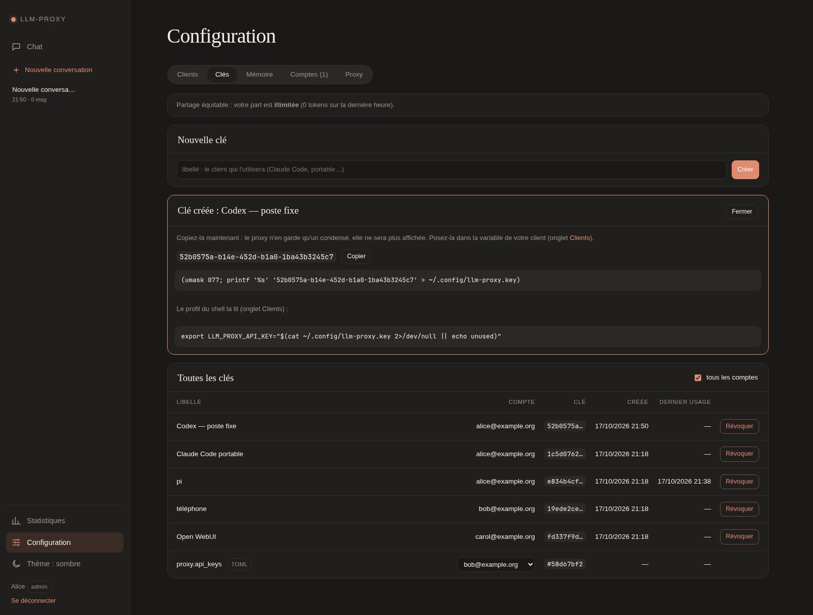

# Tableau de bord

La page web du proxy est accessible par `GET /ui` (ou `/`). Elle fournit
quatre vues : *Statistiques*, *Usage*, [*Chat*](chat.md) et
*Configuration*. Le mode
d'accès dépend de la configuration : accès sans clé si `proxy.api_keys`
n'est pas défini, accès par une [clé](#connexion-par-clé) sinon, ou accès
par des [comptes OIDC](#comptes-oidc) si `[oidc]` est configuré. La page
n'utilise aucun CDN : elle est construite par Vite (Vue 3) et servie par le
proxy, l'image la construit elle-même ([Architecture](architecture.md)).

## Navigation

Le **menu latéral** devient un tiroir ☰ sous 760 px de large. Il affiche
en haut *Chat* et la liste des conversations ; en bas, une ligne d'icônes
(*Statistiques*, *Usage*, *Configuration*, le thème : auto, clair,
sombre), la clé connectée, *Se déconnecter* et la **version** de l'image.
Cette version est le tag ou, à défaut, `sha-xxxxxxx` ; hors image, elle
vaut `dev`. Quand `LLM_PROXY_SOURCE` est posé (une adresse http ou
https), elle mène au dépôt de l'image : au tag d'une version publiée, au
commit d'un `sha-…`. La CI fournit les deux au build via
`LLM_PROXY_VERSION` et `LLM_PROXY_SOURCE`. La génération du chat continue pendant
la consultation des statistiques.

Le bouton à côté du logo active le **mode compact** : le menu devient un
rail d'icônes avec libellés en bulles, sans liste des conversations ni
pied de page. Le bouton permet de revenir au menu complet. Le choix est
conservé dans ce navigateur ; sur mobile, le menu reste un tiroir.

La page est **installable** comme une application. Le manifeste
`/ui/static/manifest.webmanifest` et le service worker `/ui/sw.js` sont
servis sans clé. Le service worker ne stocke aucune donnée ; si le proxy
est injoignable, il affiche une page « hors ligne ». L'installation
nécessite **HTTPS** (ou `localhost`) : certificat sur l'hôte derrière
Nginx Proxy Manager, `tailscale serve` ou `tailscale cert` sur un tailnet.
En HTTP, « Ajouter à l'écran d'accueil » ouvre un onglet ordinaire.

## La vue Statistiques

| Période | Couvre | Découpage | Touche |
|---|---|---|---|
| Jour | 24 dernières heures | 1 heure | <kbd>D</kbd> |
| Semaine | 7 derniers jours | 1 jour | <kbd>W</kbd> |
| Tout | depuis le plus ancien enregistrement | 1 heure ou 1 jour | <kbd>A</kbd> |

Un second sélecteur choisit la mesure affichée dans la courbe **Trafic** :
*Requêtes* (<kbd>R</kbd>) ou *Tokens* (<kbd>T</kbd>). Ces deux choix sont
conservés dans le navigateur.

- **Trafic** : axe unique et barres empilées par modèle. L'infobulle
  indique l'autre mesure et le détail. Les intervalles sans données sont
  également représentés.
- **Tableau des modèles**, sur la période exacte de la courbe :
  - *Comptage* : *exact* (bloc `usage` du backend) ou *estimé*
    (streaming sans `stream_options.include_usage`) ;
  - *Cache* : part de l'entrée servie par le cache de préfixe du backend
    (llama.cpp, vLLM), `—` si le backend ne la fournit pas (Albert) ;
  - les requêtes reçues par `/v1/messages` sont également comptées.
- **Outils** : activité des [outils hébergés](outils-heberges.md) pour la
  période. Pour chaque outil : appels, erreurs, refus par limite, durées
  moyenne et maximale, caractères transmis au modèle, dernier appel et
  répartition par route. Cette section n'apparaît que si un outil a été
  utilisé. En vue *Tout*, elle couvre la période depuis le début de la base.

La vue est actualisée toutes les 5 s, sans clignotement, uniquement lorsque
l'onglet est visible et que le chat n'est pas affiché.

Les données proviennent de `/ui/usage` et `/ui/usage/tools`, équivalents
à `/v1/organization/usage/completions` et `/v1/organization/usage/tools`
(voir [Statistiques](statistiques.md)), mais authentifiés par le cookie
de la page. La page ne consomme des tokens que lorsque le chat est ouvert
(`[ui] chat = true`).

## La vue Usage

L'usage et les limites du client de la page, admin compris (le
[périmètre](statistiques.md#usage-dun-compte-omarchy) de
`/v1/usage/agent`, tout pour un proxy ouvert) : la part équitable et le
forfait mensuel de ses backends à quotas en jauges, ses tokens des sept
derniers jours et, par modèle, l'entrée, l'entrée servie du cache et la
sortie, sur toute la base. Les jours sont ceux du fuseau du
navigateur. La vue lit `/ui/usage/agent`, le même enregistrement que
[`/v1/usage/agent`](statistiques.md#usage-dun-compte-omarchy), toutes les
30 s, uniquement lorsqu'elle est affichée et l'onglet visible.

## Connexion par clé

Lorsque `proxy.api_keys` est renseigné, la page demande une clé. Chaque
clé correspond à une personne.

- `POST /ui/login` vérifie la clé et ouvre une **session signée** dans le
  cookie `proxy_session` : `HttpOnly`, `SameSite=Lax`, durée de 30 jours,
  `Secure` en HTTPS (y compris derrière un reverse proxy qui définit
  `X-Forwarded-Proto`).
- La session ne contient que le condensé de la clé et devient invalide si
  la clé est retirée de `proxy.api_keys`. `POST /ui/logout` ferme la session.
- La clé n'est jamais transmise dans l'URL ; `?key=` n'est pas lu.
  `Authorization: Bearer` permet également d'accéder aux routes `/ui`.
- La page n'affiche que **les requêtes et outils associés à la clé** :
  `/ui/usage` et `/ui/usage/tools` appliquent ce filtre automatiquement.
- `GET /ui/session` indique l'identité connectée (fragment du condensé)
  et les fonctions disponibles dans le chat, ou répond `401`.

## Partage équitable

Le partage équitable limite la consommation de tokens par client afin
d'éviter la saturation des backends. Il ne constitue pas un quota :
aucune requête n'est refusée et aucun `429` n'est renvoyé. Chaque client
dispose d'une **part** de tokens (entrée et sortie) sur une **heure
glissante**. Une requête qui dépasse cette part attend que la consommation
repasse sous le seuil. Si le client se déconnecte pendant l'attente, la
requête est abandonnée (`499`).

- **Le client** : le compte, si la requête utilise une clé gérée, une clé
  du TOML rattachée ou la page connectée ; sinon, la clé du TOML. Un proxy
  ouvert n'a pas de client identifié.
- **La part** : `[fair_share].tokens_per_hour` (`0` = aucune limite).
  Un admin la règle par compte dans *Configuration → Comptes*, colonne
  *Part / h*, ou avec `PATCH /ui/users/<id>` `{"share": null | 0 | n}`
  (valeur par défaut, illimitée ou nombre de tokens). Augmenter la part
  libère immédiatement les requêtes en attente qui repassent sous le seuil.
- **Ce qui compte** : chaque requête relayée, après son achèvement. Sont
  exclues les routes de `[proxy].exempt_paths` (embeddings, transcription,
  OCR), les requêtes vers un backend `fair_share = false` et les requêtes
  d'un outil hébergé vers un backend.
- Les requêtes parallèles sont toutes envoyées tant que la consommation
  reste sous la part : celle-ci borne la moyenne, pas le pic.
- **Où le voir** : en tête de *Configuration → Clés* (`fair_share` dans
  `/ui/session`), dans `/healthz` détaillé (part par défaut, clients suivis,
  requêtes en attente) et dans le journal (`[partage] … relâché après …s`).
- Au démarrage, le proxy relit la dernière heure ; un redémarrage ne remet
  pas les compteurs à zéro.

## Comptes OIDC

Avec `[oidc]`, la page utilise un fournisseur OIDC (Keycloak, Authentik,
Google…) au lieu d'une clé. Chaque utilisateur dispose d'un compte, d'un
rôle et de ses propres clés.

**Mettre en route :**

1. Chez le fournisseur, créer un client confidentiel avec le flux
   *authorization code* et l'URL de retour
   `https://<adresse publique>/ui/auth/callback`.
2. Dans `config.toml`, définir les valeurs stockées dans `.env` (transmis
   au conteneur par `docker-compose.yml`) :

   ```toml
   [oidc]
   issuer = "https://…"
   client_id = "${OIDC_CLIENT_ID}"
   client_secret = "${OIDC_CLIENT_SECRET}"
   ```

3. Derrière un reverse proxy, définir `[oidc].redirect_uri` ou
   `[files].public_url`. Sans ce réglage, l'URL de retour est en `http://`
   et le fournisseur la refuse.
4. Redémarrer le proxy, puis se connecter en premier pour créer le compte
   admin.

**Connexion** : *Se connecter* → `GET /ui/auth/login` → fournisseur →
`GET /ui/auth/callback` → `/ui`. Le client [Authlib](https://docs.authlib.org/)
effectue la découverte OIDC et PKCE (S256), gère `state` et `nonce`, et
vérifie l'id_token (JWKS, `iss`, `aud`, `exp`, `nonce`). La session utilise
le même cookie qu'en mode clé, signé avec `data/client.secret`. Une clé
du proxy ne permet plus d'ouvrir la page (`/ui/login` → `404`). En cas
d'échec, la page revient à `/ui?auth_error=…`.

**Comptes** (`accounts.db`, un par identité `iss` + `sub`) :

| Rôle | Effet |
|---|---|
| `admin` | en plus : *Comptes*, les clés de tous, le générateur *Proxy* |
| `user` | accès normal |
| `pending` | ne voit que son état jusqu'à acceptation |
| `blocked` | perd la page ; ses clés cessent de valoir |

Le premier compte est admin. Les comptes suivants reçoivent le rôle défini
par `[oidc].new_accounts` : `"pending"` (défaut) ou `"user"` pour un
fournisseur réservé à l'équipe. Le dernier admin ne peut pas perdre son
rôle. L'admin gère les rôles dans *Configuration → Comptes* (`GET
/ui/users`, `PATCH /ui/users/<id>` `{"role": …}`).

**Clés** : chaque utilisateur peut créer une clé par client dans
*Configuration → Clés* (`POST /ui/keys`) et lui attribuer un libellé.

- Les clés sont des uuid4, affichées **une seule fois** avec la commande
  permettant de les enregistrer dans `~/.config/llm-proxy.key`. Le proxy
  ne conserve que leur condensé et leurs 8 premiers caractères.
- Une clé révoquée (`DELETE /ui/keys/<id>`) reste listée avec ses
  statistiques.
- Les clés sont utilisables sur `/v1/*` et `/mcp`, avec
  `Authorization: Bearer` ou `x-api-key`, comme les clés de `proxy.api_keys`.
  L'admin voit ces dernières (condensé seul), sans pouvoir les retirer,
  ainsi que toutes les clés des comptes (`GET /ui/keys?all=1`).

**Droits d'une clé sur les outils** : lors de sa création, les outils
hébergés autorisés sont définis sur *tous* (défaut) ou *seulement ceux-ci*,
sélectionnés un par un. Un serveur MCP peut être sélectionné en entier
(`mcp:<serveur>`, y compris ses futurs outils ; `mcp` pour tous les
serveurs) ou outil par outil. Le bouton *Droits* permet de modifier cette
sélection.

- API : `POST /ui/keys` `{"label": …, "tools": null | ["web_search", "mcp:docs", …]}`,
  puis `PATCH /ui/keys/<id>` `{"tools": …}` et/ou `{"label": …}` (par le
  compte propriétaire de la clé ou un admin). `GET /ui/keys/tools` liste
  les outils sélectionnables. `[]` = aucun outil : la clé ne sert qu'au modèle.
- Pour cette clé, un outil refusé est inactif : il n'est pas présenté au
  modèle sur les trois surfaces (y compris `[chat].always`) ni listé dans
  `/v1/tools` et `/mcp`. Un appel direct à `POST /v1/tools/<nom>` répond
  `403` `tool_not_permitted`.
- Une modification s'applique à la requête suivante, avec un délai de
  propagation pouvant atteindre 10 s dans un autre processus. Une clé
  révoquée ne peut plus être modifiée (`409`).
- Les droits sont associés à la **clé**, pas au compte. Le chat de la page
  et les webhooks conservent tous les outils actifs. Les clés du TOML ne
  sont pas soumises à ces droits. Un outil offert à la page seule
  (`offered`, voir [Écrire un outil](outils.md#loutil--tool)) n'est pas
  proposé dans les droits d'une clé ; ces droits ne s'y appliquent pas.

**Modèles permis d'un compte** : l'admin peut borner les modèles d'un
compte dans *Configuration → Comptes*, colonne *Modèles* : *tous* (défaut)
ou *limités* à des motifs de noms préfixés (`albert/*`,
`claude/claude-sonnet-*`, casse ignorée).

- API : `PATCH /ui/users/<id>` `{"models": null | ["albert/*", …]}` ;
  `[]` = aucun modèle.
- Un modèle hors des motifs n'apparaît ni dans `/v1/models` ni dans le
  chat, et une requête qui le vise reçoit `403` `model_not_allowed`. La
  borne vaut pour toutes les clés du compte, sa page et ses
  webhooks.
- Les [backends du compte lui-même](backends.md) n'y sont pas soumis. Les
  modèles que les outils hébergés tiennent de la configuration (OCR,
  transcription, images) non plus.
- Les clés du TOML non rattachées ne sont pas bornées.

**Rattacher une clé du TOML** : l'admin peut associer une clé de
`proxy.api_keys` à un compte dans *Clés → tous les comptes* ou avec
`PUT /ui/keys/toml/<condensé>` `{"user_id": <id> | null}`. L'association
est stockée dans `accounts.db` ; le TOML reste inchangé. La clé utilise
alors la mémoire du compte et ses statistiques sont ajoutées à celles du
compte. Elle suit également son état : un compte en attente ou bloqué
entraîne une réponse `401`. Les données enregistrées avant l'association
restent sous le condensé de la clé et ne sont pas visibles du compte.



**Partagé par un compte** : toutes les clés du compte et son chat partagent
la **même mémoire** (outil `memory`, échanges d'outils). Les statistiques
restent **par clé** (`api_key_id`) ; la page d'un compte les agrège et la
page d'un admin affiche celles de tous les comptes.

**État** : sans session, `GET /ui/auth` répond
`{"mode": "oidc" | "key" | null, "label": …}` ; le même état apparaît
dans `/healthz` détaillé (`ui_login`). `GET /ui/session` ajoute `account`
(identifiant, e-mail, nom, rôle). Le journal indique l'activation des
comptes et chaque connexion.

## L'installation

Au premier démarrage, si `data/config.toml` est absent, la page affiche
uniquement l'**installation** (`/ui/session` → `setup`) et l'API répond
503 `setup_required`. L'interface permet de sélectionner des fournisseurs
(ceux de *Ajouter un fournisseur connu*, plus bas) et des options : une
deuxième clé, le chat, Claude Code et Codex, le partage équitable et le
modèle par défaut. Elle génère trois fichiers, disponibles avec *Copier*
et *Télécharger* :

- **`.env`** : clé du proxy générée aléatoirement dans le navigateur,
  variables des fournisseurs à compléter, `SEARXNG_SECRET`, `PUID` et
  `PGID` ;
- **`data/config.toml`** ;
- **`docker-compose.override.yml`** : image publiée et variables à
  transmettre au conteneur.

La page n'écrit rien sur le proxy. Après avoir placé les fichiers,
exécuter `docker compose up -d` pour redémarrer le service. La page
demande alors la clé définie dans `.env`.

## L'onglet Configuration

L'onglet <kbd>#config</kbd> regroupe des **générateurs** exécutés dans
le navigateur ; ils n'écrivent rien sur le proxy, sauf les sections
*Proxy*, *Prompts* et *Extensions*, qui mettent à jour `data/config.toml`
pour un admin OIDC
([Enregistrer depuis la page](configuration.md#enregistrer-depuis-la-page)).

**Clients** : sélectionner un client et, sauf pour un service, un modèle
(`GET /ui/models`, disponible même lorsque le chat est désactivé). La page génère les fichiers
de configuration, y compris les outils du proxy via le [serveur MCP](outils-heberges.md#serveur-mcp--mcp),
et fournit les commandes *Copier*, *Télécharger* et les étapes à suivre.
Elle signale si la surface cible est désactivée. Les fichiers ne contiennent
jamais la clé. Le bloc *Vérifier* teste `GET /v1/models` avec la clé, puis
`tools/list` si le client utilise MCP pour les outils.

*Panneau d'agents d'Omarchy* : un service et un minuteur systemd de
l'utilisateur qui déposent toutes les 2 minutes
[`/v1/usage/agent`](statistiques.md#usage-dun-compte-omarchy) dans
`~/.local/state/omarchy/agents/usage/llm-proxy.json`. La clé est lue dans
son fichier et passe à `curl` par son entrée, jamais en argument. Pas de
modèle à choisir ; le bloc *Vérifier* donne l'état du service et le
contenu du dernier dépôt.

*Codex CLI* configure aussi la clé sous Windows en définissant une variable
d'utilisateur avec PowerShell. Le générateur indique d'utiliser
`codex doctor` pour vérifier la lecture de `config.toml`. Si Codex affiche
un modèle OpenAI à la place, le fichier est ignoré (nommé
`config.toml.txt` ou encodé autrement qu'en UTF-8), ou des lignes sont
placées sous une section existante (`[windows]`, ajoutée par Codex pour
Windows). Dans ce dernier cas, `codex doctor` indique que `windows.model`
est ignoré.

Pour Codex (CLI ou application), la case *catalogue* ajoute
`~/.codex/llm-proxy-models.json`, qui doit être téléchargé et n'est pas
affiché (`model_catalog_json`). Sans ce fichier, Codex ne connaît pas les
modèles du proxy : `/model` ne les propose pas et Codex ne tient pas
compte de leur contexte ni de leurs niveaux de raisonnement. Le fichier
remplace le catalogue intégré de Codex. Les modèles et leur contexte
proviennent du proxy ; leurs capacités d'image sont incluses si elles
sont déclarées. Les modèles de conversation y sont tous, sauf ceux que
l'on décoche sous la case ; le navigateur retient les modèles décochés,
un modèle que le proxy ajoute ensuite arrive coché, et le modèle de
départ y reste toujours. Les niveaux de raisonnement de chaque modèle
sont ceux que son backend annonce ou déclare
([`model_efforts`](configuration.md#backendsnom)), à défaut low, medium et
high ; ils sont proposés sans valeur par défaut, et aucun niveau n'est
envoyé tant qu'il n'en est pas choisi un. Le fichier est complet et ne
nécessite aucune commande. Il contient les instructions de base requises par Codex pour
chaque modèle ; elles proviennent de Codex CLI 0.167.2 (Apache-2.0) et
sont servies par la page (`config/codex-base-instructions.txt`). Télécharger
de nouveau le fichier si les modèles du proxy changent.

*Codex (application de bureau)* génère le même `~/.codex/config.toml` que
Codex CLI. Lancée depuis le Dock ou le menu Démarrer, l'application ne lit
pas le profil du shell. La page fournit donc les instructions pour définir
la variable d'environnement de la clé pour les applications :
`launchctl setenv` sous macOS ou une variable d'utilisateur via PowerShell
sous Windows. Après chaque changement de configuration ou de clé, quitter
entièrement Codex puis le relancer ; sinon le proxy répond `401`.

*pi / omp* et *OpenCode* lisent le catalogue du proxy avec une extension
TypeScript `llm-proxy.ts`, disponible par *Copier* et *Télécharger* ; son
contenu est replié sous *Afficher le fichier*. Les sources de ces
extensions sont servies par la page avec le module correspondant
(`config/pi-llm-proxy.ts`, `config/opencode-llm-proxy.ts`) :

- **pi / omp** : placer le même fichier dans `~/.pi/agent/extensions/`
  et `~/.omp/agent/extensions/`. Il enregistre les modèles du proxy sous
  le provider `llmproxy`, comme le plugin d'OpenCode. Les outils utilisent
  un fichier `mcp.json` propre à chaque client ;
- **OpenCode** (2.x) : le plugin est chargé automatiquement depuis
  `~/.config/opencode/plugins/`. Il déclare le provider `llmproxy` (modèles
  rechargés toutes les 5 min) et le serveur MCP du proxy, et retire
  `websearch` et `webfetch` d'OpenCode.

Les deux extensions lisent `LLM_PROXY_URL` et `LLM_PROXY_API_KEY` dans
l'environnement ; ces valeurs ne sont pas écrites dans les fichiers.
Sous Windows, sans profil du shell, la page définit ces variables au
niveau utilisateur avec PowerShell (clé saisie de manière masquée). Si
`/model` ne propose aucun modèle `llmproxy`, exécuter `omp models llmproxy`
(ou `pi --list-models llmproxy`) pour afficher l'erreur de l'extension,
qui n'apparaît pas dans l'interface : adresse injoignable
(`ECONNREFUSED`, nom d'hôte inconnu) ou clé refusée (`HTTP 401`). Si
aucune erreur n'est affichée, l'extension n'est pas chargée ou se trouve
dans un autre dossier.

Les scripts des postes récupèrent également ces fichiers à cette URL,
sur la branche `master` :
`https://raw.githubusercontent.com/c4software/llm-proxy/master/proxy/llm_proxy/ui/web/static/config/<fichier>`
(scripts `setup.sh` de dotarchy et `dotarchy-sync` de dev-box).

**Clés** et **Comptes** sont disponibles uniquement avec les [comptes
OIDC](#comptes-oidc).

**Dépôts** : lorsque `[repos].enabled` est actif, chaque utilisateur y déclare
ses sources (forge, adresse, jeton, projets autorisés) pour l'outil
`repository`. Voir [Dépôts](depots.md).

**Backends** : sauf `[user_backends].enabled = false`, chaque compte
déclare ses propres backends, pour lui seul ou pour tous. Voir [Backends
des comptes](backends.md).

**Quotas** (admin, ou proxy sans comptes) : l'état du limiteur de chaque
backend à quotas, relu toutes les 10 s. Par bucket (règle du backend,
limite du compte, en-têtes de l'amont, famille, générique), une barre pour
la fenêtre minute et une pour la fenêtre jour : la part prise du plafond,
marge `[quotas].margin` comprise, et, la fenêtre presque pleine, le délai
avant qu'une place se libère. Le restant annoncé par Albert ou par les
en-têtes de l'amont et les `429` reçus du backend malgré le limiteur y
figurent, ainsi que le [forfait
mensuel](configuration.md#forfait-mensuel-mistral) d'un compte Mistral
(API, Vibe & Studio : consommé, alloué, réinitialisation). Seul ce qui est
reçu ou défini s'affiche : une fenêtre sans plafond, un bucket sans fenêtre
ni restant et un backend sans rien de tout cela sont omis. *Relire
les limites* interroge le compte sans attendre (au plus une fois par 30 s).
Voir [`[quotas]`](configuration.md#quotas).

**Webhooks** : lorsque `[webhooks].enabled` et `[ui].chat` sont actifs,
chaque utilisateur peut définir des webhooks entrants (message reçu au
format Slack, auquel le modèle répond dans une conversation du chat) et
sortants (URL compatible avec Slack). Voir [Webhooks](webhooks.md).

**Exécution** : avec l'exécuteur de code configuré (`[tools.code_execution]`
`url` et `token`), chaque utilisateur voit ses bacs associés à une
conversation ou à ses dépôts : âge, inactivité et échéance. Il peut
détruire chaque bac séparément ou tous à la fois. Un admin (comptes OIDC)
ou la page connectée (sans OIDC) voit également l'état et les limites de
l'exécuteur, les bacs de tous les comptes et les caches du proxy (pages
web, archives des dépôts, transcriptions, résultats et échanges d'outils).
Il peut vider ces caches. La destruction d'un bac supprime ses fichiers,
même pendant une exécution. Après la suppression d'une entrée de cache,
le proxy la relit au besoin.

**Extensions** : cette section est accessible à un admin avec les comptes
OIDC, ou à la page connectée sans OIDC. Elle décrit les extensions de
`[extensions].path` qui sont chargées, leurs outils, leur lieu d'exécution
(proxy ou navigateur), leur surface de disponibilité et leur état de
configuration, ainsi que les extensions rejetées et leur motif. Une
extension déposée apparaît désactivée après le démarrage suivant. Le bouton
*Activer* met l'outil en service (par exemple, côté proxy seulement, sans
le navigateur) ; *Désactiver* le retire immédiatement de toutes les
surfaces. L'état est écrit dans `data/config.toml` et survit aux
redémarrages. Les boutons n'existent que pour un admin OIDC : sans comptes
OIDC, la page n'écrit pas `config.toml`. Voir
[Extensions](extensions.md#activer-et-désactiver).

**Prompts** : mêmes droits que *Extensions*. La section liste les textes
que le modèle lit (descriptions des outils, consignes), par domaine, avec
une recherche. *Modifier* puis *Enregistrer* remplace un texte pour tout
le proxy ; *Rétablir* rend le texte par défaut. Voir [Prompts](prompts.md).

**Proxy** : sections de configuration Accès, Backends, Surfaces, Outils,
Partage équitable, Comptes, Divers, Avancé, Fichier complet, `.env` et
Override Docker. Cette vue est réservée aux admins lorsque les comptes
OIDC sont activés.

- **Backends** : *Ajouter un fournisseur connu* préremplit le nom, l'URL
  et la variable de clé pour NVIDIA, AMD Token Lab, Groq, Mistral,
  OpenRouter, OpenCode Go et Albert, comme dans le
  [TP du cours](https://cours.brosseau.ovh/tp/agentic/proxy.html). Anthropic
  est également disponible en [backend natif](configuration.md#backend-anthropic)
  (`api = "anthropic"`). Le *protocole* de chaque backend (OpenAI ou
  Anthropic) se sélectionne sur sa ligne. Ses *en-têtes*
  ([`headers`](configuration.md#backendsnom)) se donnent par leurs noms :
  chaque valeur devient une variable `${VAR}` du `.env`, comme une clé,
  et n'est jamais affichée.
- **Override Docker** : le fichier `docker-compose.override.yml` du
  service `albert-proxy` contient l'[image publiée](deploiement.md#limage-publiée)
  et les variables `${VAR}` du fichier complet que `docker-compose.yml`
  ne transmet pas déjà. Sans cet override, ces variables restent dans
  `.env` et le backend démarre sans clé.

- Les **sections** sont initialisées à partir de la configuration active
  (`GET /ui/config`). Une modification ne change que la ligne concernée
  du fichier (`POST /ui/config/merge`) ; la suppression d'un backend le
  retire du fichier.
- **Avancé** : affiche et permet de modifier les autres réglages (délais,
  `[quotas]`, `model_map`, serveurs MCP…), avec l'état *défaut* ou
  *modifié*. Le **rôle** du réglage est indiqué sous sa valeur et celui
  de la table sous son titre. Le filtre porte sur le nom et le rôle
  (« relais » trouve `linux_relay`). Les rôles proviennent des commentaires
  de `data/config.example.toml` (`core/config_docs.py`) : commentaire
  au-dessus d'une clé, commentaire de la table pour les clés sans
  commentaire, et liste « Champs » pour les backends (un champ par ligne,
  `#   nom — rôle`). Un test refuse tout réglage lu par le proxy sans
  description. Le texte est rendu en Markdown ; un renvoi vers
  `docs/….md`, éventuellement suivi de `, « Titre »`, ouvre la section
  correspondante sur GitHub dans la version déployée (son tag, sinon
  `master`). Un test vérifie l'existence de chaque fichier et titre cités.
- **Fichier complet** : affiche le `data/config.toml` résultant, avec les
  valeurs par défaut suivies de `# défaut`, les `${VAR}` conservés et les
  secrets en clair masqués. Une modification manuelle n'est plus écrasée
  par les sections ; *Réappliquer les sections* les rétablit.
- **Vérifier** (`POST /ui/config/check`) : valide la syntaxe TOML et
  signale les clés inconnues, qu'une faute de frappe rendrait autrement
  inopérantes sans avertissement.
- **Enregistrer** (`POST /ui/config/save`, admin OIDC) met à jour
  `data/config.toml` sur le proxy, valeur par valeur (commentaires,
  `${VAR}` et secrets masqués gardés, ancienne version dans
  `config-history/`), puis le recharge. La page indique les réglages
  appliqués et ceux qui nécessitent un redémarrage ; si le fichier a changé
  entre-temps, elle relit la configuration. Sans comptes OIDC, le bouton
  est absent. Voir
  [Enregistrer depuis la page](configuration.md#enregistrer-depuis-la-page).
- **Recharger** (`POST /ui/config/reload`) relit le fichier tel qu'il est
  (modifié à la main) ; **Copier** et **Télécharger** donnent le fichier
  complet sans l'écrire. Voir
  [Rechargement à chaud](configuration.md#rechargement-à-chaud).
