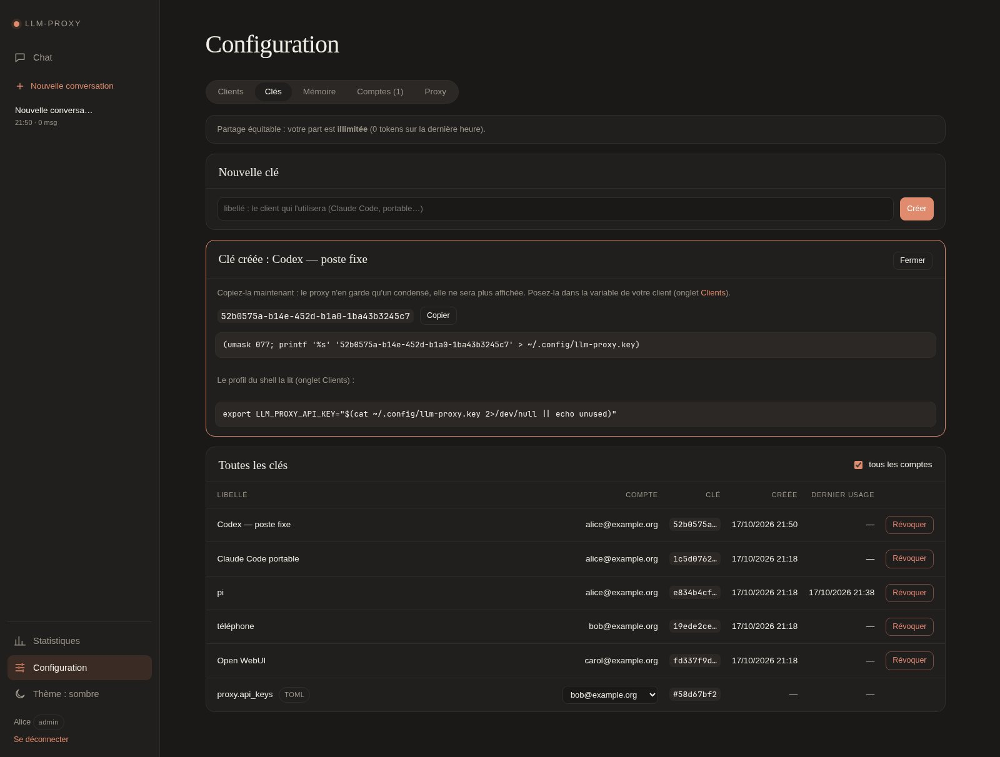

# Tableau de bord

La page web du proxy s'ouvre sur `GET /ui` (ou `/`). Elle réunit trois
vues : *Statistiques*, [*Chat*](chat.md) et *Configuration*. Son accès
dépend de la configuration : ouverte sans `proxy.api_keys`, protégée par
une [clé](#connexion-par-clé) sinon, ou par des
[comptes OIDC](#comptes-oidc) avec `[oidc]`. Aucun CDN ni compilation :
Vue 3 est embarqué.

## Navigation

Un **menu latéral** (tiroir ☰ sous 760 px de large) donne en haut *Chat*
et la liste des conversations, en bas *Statistiques*, *Configuration*,
la clé connectée, *Se déconnecter* et le thème (auto, clair, sombre).
Une réponse du chat continue pendant qu'on regarde les statistiques.
Le bouton à côté du logo le passe en **mode compact** : un rail d'icônes
(libellés en bulles), sans la liste des conversations ni le pied, à
déplier pour y revenir. Le choix reste dans ce navigateur ; sur mobile,
le menu reste un tiroir.

La page est **installable** comme une application (manifeste
`/ui/static/manifest.webmanifest`, service worker `/ui/sw.js`, servis
sans clé). Le service worker ne garde rien ; proxy injoignable, il
affiche une page « hors ligne ». L'installation exige **HTTPS** (ou
`localhost`) : certificat sur l'hôte derrière Nginx Proxy Manager,
`tailscale serve` ou `tailscale cert` sur un tailnet. En HTTP, « Ajouter
à l'écran d'accueil » ouvre un simple onglet.

## La vue Statistiques

| Période | Couvre | Découpage | Touche |
|---|---|---|---|
| Jour | 24 dernières heures | 1 heure | <kbd>D</kbd> |
| Semaine | 7 derniers jours | 1 jour | <kbd>W</kbd> |
| Tout | depuis le plus ancien enregistrement | 1 heure ou 1 jour | <kbd>A</kbd> |

Un second sélecteur choisit la mesure de la courbe **Trafic** :
*Requêtes* (<kbd>R</kbd>) ou *Tokens* (<kbd>T</kbd>). Les deux choix sont
mémorisés dans le navigateur.

- **Trafic** : un seul axe, barres empilées par modèle. L'infobulle
  donne l'autre mesure et le détail. Les seaux vides sont dessinés.
- **Tableau des modèles**, sur la période exacte de la courbe :
  - *Comptage* : *exact* (bloc `usage` du backend) ou *estimé*
    (streaming sans `stream_options.include_usage`) ;
  - *Cache* : part de l'entrée servie par le cache de préfixe du backend
    (llama.cpp, vLLM), `—` s'il ne la remonte pas (Albert) ;
  - les requêtes arrivées par `/v1/messages` sont comptées.
- **Outils** : les [outils hébergés](outils-heberges.md) de la période.
  Par outil : appels, erreurs, refus par limite, durée moyenne et
  maximale, caractères rendus au modèle, dernier appel, répartition par
  route. Absente si aucun outil n'a servi. En vue *Tout*, elle part du
  début de la base.

La vue se rafraîchit toutes les 5 s, sans clignoter, et jamais quand
l'onglet est masqué ou que le chat est affiché.

Les chiffres viennent de `/ui/usage` et `/ui/usage/tools`, identiques à
`/v1/organization/usage/completions` et `/v1/organization/usage/tools`
(voir [Statistiques](statistiques.md)) mais authentifiés par le cookie
de la page. La page ne dépense des tokens que si le chat est ouvert
(`[ui] chat = true`).

## Connexion par clé

Si `proxy.api_keys` est renseigné, la page demande une clé (une clé, une
personne).

- `POST /ui/login` la vérifie et ouvre une **session signée** : cookie
  `proxy_session`, `HttpOnly`, `SameSite=Lax`, 30 jours, `Secure` en
  HTTPS (y compris derrière un reverse proxy qui pose
  `X-Forwarded-Proto`).
- La session ne porte que le condensé de la clé, et cesse si la clé
  quitte `proxy.api_keys`. `POST /ui/logout` la ferme.
- La clé ne passe jamais par l'URL : `?key=` n'est pas lu.
  `Authorization: Bearer` ouvre aussi les routes `/ui`.
- On ne voit que **les requêtes et outils de sa clé** : `/ui/usage` et
  `/ui/usage/tools` filtrent d'office.
- `GET /ui/session` dit qui est connecté (fragment du condensé) et ce
  que le chat peut faire, ou répond `401`.

## Partage équitable

Le partage équitable empêche un client (un agent qui boucle) de saturer
les backends. Ce n'est pas un quota : **rien n'est refusé**, aucun
`429`. Chaque client a une **part** de tokens (entrée + sortie) sur une
**heure glissante**. Au-delà, sa requête **attend** de repasser sous la
part. Un client qui raccroche pendant l'attente est abandonné (`499`).

- **Le client** : le compte (clé gérée, clé du TOML rattachée, page
  connectée), sinon la clé du TOML. Proxy ouvert : personne.
- **La part** : `[fair_share].tokens_per_hour` (`0` = aucune limite).
  Un admin la règle par compte (*Configuration → Comptes*, colonne
  *Part / h*, ou `PATCH /ui/users/<id>` `{"share": null | 0 | n}` :
  défaut, illimitée, ou un nombre). La relever libère aussitôt qui
  attend.
- **Ce qui compte** : chaque requête relayée, une fois terminée. Sauf
  les routes de `[proxy].exempt_paths` (embeddings, transcription, OCR),
  un backend `fair_share = false`, et les appels d'un outil hébergé à un
  backend.
- Des requêtes parallèles sous la part partent toutes : la part borne la
  moyenne, pas la pointe.
- **Où le voir** : en tête de *Configuration → Clés* (`fair_share` de
  `/ui/session`) ; `/healthz` détaillé (part par défaut, clients suivis,
  en attente) ; le journal (`[partage] … relâché après …s`).
- Au démarrage, la dernière heure est relue : un redémarrage ne remet
  personne à zéro.

## Comptes OIDC

Avec `[oidc]`, la page s'ouvre par un fournisseur OIDC (Keycloak,
Authentik, Google…) au lieu d'une clé. Chacun a un compte, un rôle et
ses propres clés.

**Mettre en route :**

1. Chez le fournisseur : un client confidentiel, flux *authorization
   code*, retour `https://<adresse publique>/ui/auth/callback`.
2. Dans `config.toml`, les valeurs dans `.env` (transmis au conteneur
   par `docker-compose.yml`) :

   ```toml
   [oidc]
   issuer = "https://…"
   client_id = "${OIDC_CLIENT_ID}"
   client_secret = "${OIDC_CLIENT_SECRET}"
   ```

3. Derrière un reverse proxy, poser `[oidc].redirect_uri` ou
   `[files].public_url`. Sinon l'adresse de retour est en `http://` et le
   fournisseur la refuse.
4. Redémarrer et se connecter **le premier** : ce compte est admin.

**Connexion** : *Se connecter* → `GET /ui/auth/login` → fournisseur →
`GET /ui/auth/callback` → `/ui`. Client [Authlib](https://docs.authlib.org/) :
découverte, PKCE (S256), `state`, `nonce`, id_token vérifié (JWKS,
`iss`, `aud`, `exp`, `nonce`). La session est le même cookie qu'en mode
clé, signé d'après `data/client.secret`. Une clé du proxy n'ouvre plus
la page (`/ui/login` → `404`). Un échec renvoie sur
`/ui?auth_error=…`.

**Comptes** (`accounts.db`, un par identité `iss` + `sub`) :

| Rôle | Effet |
|---|---|
| `admin` | en plus : *Comptes*, les clés de tous, le générateur *Proxy* |
| `user` | accès normal |
| `pending` | ne voit que son état jusqu'à acceptation |
| `blocked` | perd la page ; ses clés cessent de valoir |

Le premier compte est admin. Les suivants prennent
`[oidc].new_accounts` : `"pending"` (défaut) ou `"user"` pour un
fournisseur déjà réservé à votre équipe. Le dernier admin ne peut pas
perdre son rôle. L'admin gère les rôles dans *Configuration → Comptes*
(`GET /ui/users`, `PATCH /ui/users/<id>` `{"role": …}`).

**Clés** : chacun crée les siennes dans *Configuration → Clés*
(`POST /ui/keys`), une par client, avec un libellé.

- Ce sont des uuid4, montrés **une seule fois**, avec la commande qui la
  pose dans `~/.config/llm-proxy.key`. Le proxy n'en garde que le
  condensé et les 8 premiers caractères.
- Révoquée (`DELETE /ui/keys/<id>`), une clé reste listée avec ses
  statistiques.
- Elles valent partout (`/v1/*`, `/mcp`, `Authorization: Bearer` ou
  `x-api-key`), à côté de celles de `proxy.api_keys`. L'admin voit
  celles-ci (condensé seul) sans pouvoir les retirer, et les clés de
  tous (`GET /ui/keys?all=1`).

**Rattacher une clé du TOML** : l'admin peut lier une clé de
`proxy.api_keys` à un compte (*Clés → tous les comptes*, ou
`PUT /ui/keys/toml/<condensé>` `{"user_id": <id> | null}`). Le lien vit
dans `accounts.db`, le TOML ne change pas. La clé écrit alors dans la
mémoire du compte, ses statistiques s'y ajoutent, et elle suit l'état
du compte (en attente ou bloqué = `401`). Ce qu'elle avait rangé avant
reste sous son condensé, hors de vue du compte.



**Partagé par un compte** : toutes ses clés et son chat ont **la même
mémoire** (outil `memory`, échanges d'outils). Les statistiques restent
**par clé** (`api_key_id`) ; la page d'un compte les réunit, celle d'un
admin montre tout le monde.

**État** : `GET /ui/auth` (sans session) répond
`{"mode": "oidc" | "key" | null, "label": …}`, répété par `/healthz`
détaillé (`ui_login`). `GET /ui/session` ajoute `account` (identifiant,
e-mail, nom, rôle). Le journal note l'activation des comptes et chaque
connexion.

## L'onglet Configuration

L'onglet <kbd>#config</kbd> regroupe des **générateurs** qui tournent
dans le navigateur : rien n'est écrit sur le proxy.

**Clients** : choisir un client et un modèle (`GET /ui/models`, servi
même chat fermé) ; la page produit ses fichiers de configuration, outils
du proxy par le [serveur MCP](outils-heberges.md#serveur-mcp--mcp)
compris, avec *Copier*, *Télécharger* et les étapes, et prévient si la
surface visée est désactivée. La clé n'est jamais écrite dans ces
fichiers ; le bloc *Vérifier* teste `GET /v1/models` avec elle, puis
`tools/list` si le client prend les outils par MCP.

**Clés** et **Comptes** : avec les [comptes OIDC](#comptes-oidc)
seulement.

**Proxy** : toute la configuration, en sections (Accès, Backends,
Surfaces, Outils, Partage équitable, Comptes, Divers, Avancé, Fichier
complet, `.env`). Réservé aux admins avec les comptes OIDC.

- Les **sections** partent de la configuration en vigueur (`GET
  /ui/config`). Un changement ne modifie que sa ligne du fichier
  (`POST /ui/config/merge`) ; un backend retiré en disparaît.
- **Avancé** : chaque autre réglage (délais, `[quotas]`, `model_map`,
  serveurs MCP…), éditable, marqué *défaut* ou *modifié*, avec un
  filtre.
- **Fichier complet** : le `data/config.toml` résultant, défauts suivis
  de `# défaut`, `${VAR}` gardés, secrets en clair masqués. Édité à la
  main, il n'est plus écrasé par les sections (*Réappliquer les
  sections* les rétablit).
- **Vérifier** (`POST /ui/config/check`) : syntaxe TOML et clés
  inconnues, qu'une faute de frappe rendrait sinon inertes sans un mot.
- **Appliquer**, c'est remplacer `data/config.toml` sur l'hôte (l'ancien
  en `.bak`, valeurs masquées remises) et redémarrer.
